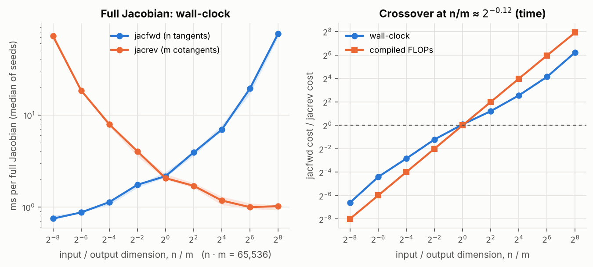
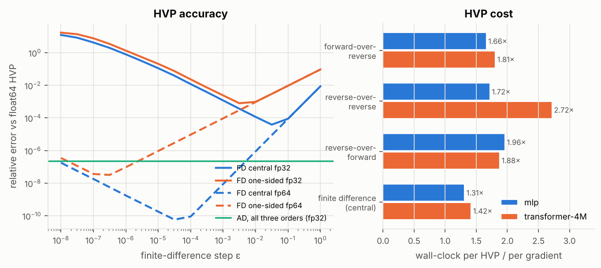
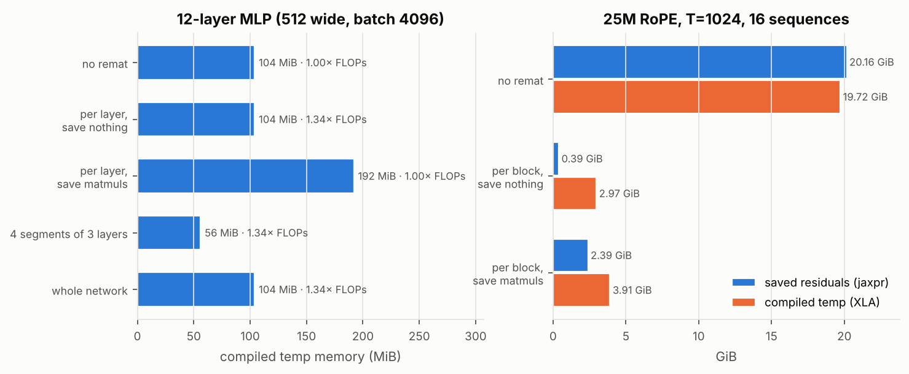

# M1 — Autodiff internals and Newton's method

> **Status:** O1 done; O2 (Newton / IRLS, autodiff boosting) next ·
> **Hardware:** CPU, 4 cores, x86_64. No GPU was used, and every wall-clock number is from this CPU ·
> **Data:** [`data/o1-jacobian.json`](data/o1-jacobian.json), [`data/o1-hvp.json`](data/o1-hvp.json), [`data/o1-remat.json`](data/o1-remat.json) ·
> **Reproduce:** `uv run python experiments/o1_autodiff/run.py jacobian hvp remat plot` (about 4 minutes)

## O1 — Forward vs reverse mode, Hessian-vector products, rematerialisation

### Question

ml-ladder's B1 left three autodiff ideas as open threads:

- forward mode, for Jacobian-vector products;
- Hessian-vector products, for second-order methods;
- checkpointing, which recomputes activations instead of storing them.

JAX exposes all three as one-line transformations. For each, the textbook makes
a cost claim. Which of those claims hold when the program is compiled by XLA
and run on real hardware?

### The idea

Reverse mode (`vjp`) costs about one backward pass per *output*. Forward mode
(`jvp`) costs one tangent pass per *input*.

So a full Jacobian of $f:\mathbb{R}^n\to\mathbb{R}^m$ should favour forward mode
when $n<m$, and reverse mode when $n>m$.

A Hessian-vector product $Hv$ composes the two modes. It needs no $D\times D$
Hessian and should cost a small constant times one gradient (Pearlmutter, 1994).

Checkpointing (`jax.checkpoint`, also called remat) trades memory for compute:
- **Store less:** keep only some activations from the forward pass.
- **Recompute the rest:** rebuild them during the backward pass.
- **Price:** about one extra forward pass, so $4/3$ the FLOPs if backward costs
  $2\times$ forward.

Every cost here is read two ways:
- **From the compiled XLA program:** its FLOPs (`cost_analysis`) and buffer
  bytes (`memory_analysis`). These are deterministic.
- **From the jaxpr:** `saved_residuals`, which lists what reverse mode keeps
  between the forward and backward passes.

Wall-clock comes third. On a shared 4-core CPU it is the noisiest of the three.

### The math

**Jacobian.** `jacfwd` pushes the $n$ basis tangents through as one batched
`jvp`. `jacrev` pulls the $m$ basis cotangents back through one batched `vjp`.

For a tanh MLP with hidden width $h$, depth $L$, input $n$ and output $m$:

$$\text{FLOPs}(\texttt{jacfwd}) \approx n\,(2hn + 2Lh^2 + 2hm),
\qquad \text{FLOPs}(\texttt{jacrev}) \approx m\,(2hn + 2Lh^2 + 2hm).$$

They are equal exactly at $n=m$. With $nm$ fixed, their ratio is $n/m$ times a
factor that grows with the imbalance.

**HVP, three exact orders.** With $g=\nabla f$:

- forward-over-reverse: $Hv = \partial_\varepsilon\, g(p+\varepsilon v)\big|_0$, as `jvp(grad(f))`;
- reverse-over-reverse: $Hv = \nabla_p\,\langle g(p), v\rangle$, as `grad(vdot(grad(f), v))`;
- reverse-over-forward: $Hv = \nabla_p\,\big(\partial_\varepsilon f(p+\varepsilon v)\big)$, as `grad(jvp(f))`.

**Finite differences.** A step $\varepsilon$ in machine precision $\epsilon_m$
trades truncation error against round-off:

| finite difference | formula | truncation | round-off | best step | best error |
| --- | --- | --- | --- | --- | --- |
| central | $(g(p+\varepsilon v)-g(p-\varepsilon v))/2\varepsilon$ | $O(\varepsilon^2)$ | $O(\epsilon_m/\varepsilon)$ | $\varepsilon^\star\sim\epsilon_m^{1/3}$ | $\epsilon_m^{2/3}$ |
| one-sided | $(g(p+\varepsilon v)-g(p))/\varepsilon$ | $O(\varepsilon)$ | $O(\epsilon_m/\varepsilon)$ | $\varepsilon^\star\sim\epsilon_m^{1/2}$ | $\epsilon_m^{1/2}$ |

In fp32 ($\epsilon_m = 1.19\times10^{-7}$) the predicted best errors are
$2.4\times10^{-5}$ and $3.4\times10^{-4}$.

**Rematerialisation.** For $L$ layers in $k$ segments, segment checkpointing
keeps the $L/k$ boundary activations, plus one segment's $k$ internal
activations during the backward pass. That is minimised at $k=\sqrt{L}$.

### What we measure and why

- **jvp vs vjp.** One function family: a tanh MLP with $h=512$, 4 hidden
  layers, and $nm = 2^{16}$ fixed while $n/m$ is swept from $2^{-8}$ to $2^{8}$.
  - Measured: wall-clock (median of seeds 0–2), compiled FLOPs, and agreement
    between the two Jacobians.
  - Also measured, at $n=m=256$: single `jvp`, `vjp` (input only), `vjp`
    w.r.t. the weights and input, and `linearize`-then-apply, each relative
    to one forward pass. Two batch sizes: 1 and 256.
- **HVP.** The loss is the cross-entropy of an MLP classifier (32 → 128 → 10,
  batch 512; 5,376 parameters), with a random unit direction $v$.
  - Reference: forward-over-reverse in **float64**. It agrees with float64
    reverse-over-reverse to $1.9\times10^{-16}$.
  - Accuracy: the three AD orders in fp32, and both finite differences in fp32
    and fp64, over $\varepsilon = 10^{-8}\dots1$ in half-decade steps.
  - Cost: time, FLOPs and temp memory relative to one gradient, on that MLP
    and on R2's 4M transformer (T = 128, batch 4).
- **Remat**, on two models.
  - **A 12-layer tanh MLP** (512 wide, batch 4096), chosen so that
    activations outweigh the weights. Five arms:
    - no remat;
    - checkpoint every layer;
    - every layer with `dots_saveable`;
    - 4 segments of 3 layers;
    - the whole network as one checkpoint.
  - **The R2 transformer.** Three arms:
    - no remat;
    - per-block checkpoint saving nothing;
    - per-block with `dots_with_no_batch_dims_saveable`.

    The 4M model is timed at T = 256 with 16 sequences. The 25M RoPE model at
    R2's real step (16 × 1024 tokens) is only compiled: it is too slow to time
    on this CPU, and the compiled program's buffer sizes do not need it to run.

### What I built

- **`experiments/o1_autodiff/run.py`**: the three experiments and the
  figures. HVP runs with `jax_enable_x64`; every fp32 problem is drawn in fp64
  and cast, so it is the reference problem rounded. (The same PRNG key gives
  *different numbers* per dtype, and an early run compared against the wrong
  problem because of it.)
- **`src/jaxexp/bench.py`**, three helpers that later experiments reuse:
  - `time_call`: median wall-clock after a warm-up call that also compiles;
  - `compiled_stats`: FLOPs and memory of the compiled program, without
    running it;
  - `residual_stats`: what reverse mode saves, excluding arguments and
    closed-over constants.
- **`jaxexp.transformer.CharTransformer(..., remat=True, policy=...)`**:
  per-block `nnx.remat`, opt-in. R2 needs it (see Results).
- **`src/jaxexp/plotting.py`**: the house figure style.

### Results

**Forward vs reverse mode for full Jacobians.**

| $n$ | $m$ | $n/m$ | `jacfwd` (ms) | `jacrev` (ms) | time fwd/rev | FLOPs fwd/rev |
| --- | --- | --- | --- | --- | --- | --- |
| 16 | 4096 | $2^{-8}$ | 0.75 (0.75–0.81) | 72.04 (66.79–78.62) | 0.010 | 0.004 |
| 64 | 1024 | $2^{-4}$ | 1.13 (1.05–1.15) | 7.94 (7.52–8.36) | 0.140 | 0.063 |
| 128 | 512 | $2^{-2}$ | 1.75 (1.62–1.75) | 4.03 (3.56–4.04) | 0.433 | 0.251 |
| 256 | 256 | $2^{0}$ | 2.16 (2.10–2.40) | 2.06 (2.00–2.28) | 1.052 | 1.000 |
| 512 | 128 | $2^{2}$ | 3.93 (3.59–4.00) | 1.70 (1.62–1.83) | 2.308 | 3.979 |
| 1024 | 64 | $2^{4}$ | 6.93 (6.92–7.75) | 1.18 (1.05–1.30) | 5.866 | 15.786 |
| 4096 | 16 | $2^{8}$ | 76.38 (69.86–78.76) | 1.02 (0.93–1.04) | 74.690 | 241.370 |

The full sweep is in the JSON, with all nine ratios. The two Jacobians agree to
about $1.1\times10^{-6}$ relative.

**The crossover:**
- **In FLOPs:** at exactly $n/m = 1$.
- **In wall-clock:** at $n/m = 2^{-0.115}$, that is 0.92, across seeds
  ($2^{-0.117}$ to $2^{-0.115}$). Forward mode becomes the slower of the two
  slightly before $n = m$.

Away from the crossover, time compresses the FLOP ratio. A 241× FLOP
disadvantage costs 75× in time, and a 252× FLOP advantage buys 97×. The cheap
side sits on a floor of about 1 ms.

**Single products, relative to one forward pass** ($n=m=256$; time as a
median, with the min–max over seeds):

| product | FLOPs | time, batch 1 | time, batch 256 |
| --- | --- | --- | --- |
| `jvp` (primal and tangent) | 2.00× | 1.55× (1.39–1.74) | 2.00× (1.45–2.03) |
| `vjp` w.r.t. input (forward and pullback) | 2.00× | 2.04× (1.91–2.72) | 1.64× (1.17–1.89) |
| `vjp` w.r.t. weights and input | 2.51× (batch 1), 3.00× (batch 256) | 3.69× (3.16–4.01) | 2.41× (1.81–2.69) |
| `linearize` once, then apply | 1.00× | 1.16× (1.15–1.19) | 0.91× (0.63–0.96) |

What these rows show:
- **The textbook cost ratios hold exactly.** The jvp is 2× a forward pass. The
  parameter gradient is 3×: the forward pass, the backward pass to the inputs,
  and the weight-gradient matmuls.
- **The batch-1 weight gradient reads 2.51×, not 3×.** Its weight gradients
  are outer products, and XLA counts one FLOP per output element for those.
- **`linearize` amortises.** The primal is computed once, after which each
  further jvp costs one forward pass.
- **Little is saved for the backward pass.** The input `vjp` keeps 4 tensors:
  8 KiB at batch 1 and 2 MiB at batch 256. They are $1-\tanh^2$, the
  derivative itself, not the activation.

**Hessian-vector products: accuracy.**

| method | precision | best $\varepsilon$ | relative error |
| --- | --- | --- | --- |
| forward-over-reverse | fp32 | — | $2.25\times10^{-7}$ ($2.23$–$2.28$) |
| reverse-over-reverse | fp32 | — | $2.27\times10^{-7}$ ($2.24$–$2.28$) |
| reverse-over-forward | fp32 | — | $2.27\times10^{-7}$ ($2.24$–$2.28$) |
| central difference | fp32 | $3\times10^{-2}$ | $3.9\times10^{-5}$ |
| one-sided difference | fp32 | $3\times10^{-3}$ | $8.0\times10^{-4}$ |
| central difference | fp64 | $3\times10^{-5}$ | $5.8\times10^{-11}$ |
| one-sided difference | fp64 | $3\times10^{-7}$ | $3.2\times10^{-8}$ |

**Hessian-vector products: cost relative to one gradient.**

| method | MLP time | MLP FLOPs | 4M transformer time | 4M FLOPs | 4M temp memory |
| --- | --- | --- | --- | --- | --- |
| forward-over-reverse | 1.66× (1.52–1.79) | 1.89× | **1.81×** (1.80–1.85) | 2.66× | 1.99× |
| reverse-over-reverse | 1.72× (1.68–1.73) | 1.89× | **2.72×** (2.68–2.76) | 2.68× | 2.19× |
| reverse-over-forward | 1.96× (1.70–1.98) | 1.89× | 1.88× (1.79–2.04) | 2.66× | 2.15× |
| central difference, $\varepsilon=10^{-2}$ | 1.31× (1.25–1.54) | 2.00× | 1.42× (1.30–1.49) | 2.13× | 2.02× |

A 4M-transformer gradient takes 133 ms (130–137); an MLP gradient takes 0.4 ms.

**Rematerialisation, 12-layer MLP** (512 wide, batch 4096). "Residuals" is what
the jaxpr saves; "temp" is XLA's compiled scratch memory:

| arm | residuals | temp | FLOPs | time |
| --- | --- | --- | --- | --- |
| no remat | 192 MiB | **104 MiB** | 1.000× | 237 ms (235–239) |
| per layer, save nothing | 96 MiB | **104 MiB** | 1.342× | 1.26× |
| per layer, save matmuls | 192 MiB | 192 MiB | 1.001× | 1.23× |
| 4 segments of 3 layers | 32 MiB | **56 MiB** | 1.342× | 1.10× |
| whole network | 8 MiB | **104 MiB** | 1.342× | 1.15× |

Every arm's gradient is bitwise identical to no remat's.

**Rematerialisation, the R2 transformer:**

| model | arm | residuals | temp | FLOPs | time |
| --- | --- | --- | --- | --- | --- |
| 4M, T = 256, 16 sequences | no remat | 841 MiB | 868 MiB | 1.000× | 732 ms (704–786) |
| | per block, save nothing | 40 MiB | 224 MiB | 1.256× | **0.88×** |
| | per block, save matmuls | 200 MiB | 296 MiB | 1.073× | **0.76×** |
| 25M RoPE, T = 1024, 16 sequences | no remat | 20.2 GiB | **19.7 GiB** | 1.000× | (compiled only) |
| | per block, save nothing | 0.39 GiB | **2.97 GiB** | 1.259× | |
| | per block, save matmuls | 2.39 GiB | **3.91 GiB** | 1.096× | |

**Where the textbook holds, and where it doesn't:**

- **"Choose the mode by the shape of the Jacobian": holds.**
  - The FLOP crossover is at exactly $n=m$, and the time crossover at
    $n/m=0.92$.
  - Wall-clock is less extreme than the FLOP count at both ends.
- **"A jvp costs about 2× a forward pass, a gradient about 3×": holds
  exactly in FLOPs** (2.00× and 3.00×). Wall-clock lands at 1.5–2× and
  2.4–3.7×.
- **"An HVP costs a small constant times a gradient": holds.**
  - It costs 1.9–2.7× in FLOPs and 1.7–2.7× in time.
  - The three exact orders are equally accurate, at fp32 round-off.
  - **They are not equally fast.** On the transformer, reverse-over-reverse
    is 1.5× slower than forward-over-reverse at the same FLOPs, which is why
    forward-over-reverse is the recommended default.
- **"Finite differences lose a third (central) or half (one-sided) of the
  digits": holds**, within 2.4× of the predicted best error:
  - central: $3.9\times10^{-5}$ against $2.4\times10^{-5}$ predicted in fp32,
    and $5.8\times10^{-11}$ against $3.7\times10^{-11}$ in fp64;
  - one-sided: $8.0\times10^{-4}$ against $3.4\times10^{-4}$ in fp32, and
    $3.2\times10^{-8}$ against $1.5\times10^{-8}$ in fp64.

  The best fp32 central step, $3\times10^{-2}$, is 6× the textbook
  $\epsilon_m^{1/3}$, because the optimum also scales with the function. At its
  best step, central FD is **170× less accurate** than any AD order. It is also
  cheaper in time (1.3–1.4× a gradient), since its two gradient calls compile
  into one program.
- **"Checkpointing costs one extra forward pass": holds.** The cost is 1.342×
  the FLOPs, against $4/3$.
- **"Checkpointing saves memory": only for the right granularity.**
  - **Per layer and whole network: no saving on the MLP.** Checkpointing a
    one-op layer keeps its input, and its input is the previous layer's
    output, which no remat kept anyway. Checkpointing the whole network just
    moves the forward pass into the backward pass, where all its activations
    are live again.
  - **Segments:** 4 segments of 3 almost halve the memory (104 → 56 MiB).
    56 MiB is exactly seven 8 MiB activations: the 4 segment boundaries plus
    one segment's 3 layers. No remat holds thirteen.
  - **Save-matmuls on the MLP: worse than no remat** (192 MiB). It keeps the
    pre-activations as well as the outputs.
  - **Transformer blocks are where per-block remat pays.** A block's
    attention and MLP activations are much larger than its input: −74% on
    the 4M model, and −85% on the 25M.

### What surprised me

**R2's step does not fit on a T4 without remat.**
- In fp32 with explicit attention, the 25M RoPE model at 16 × 1024 tokens
  needs **19.7 GiB** of scratch memory. A T4 has 16 GB.
- Most of it is attention. One layer's probabilities alone are
  16 × 8 × 1024² × 4 B = 512 MiB, and every layer keeps several such tensors.
- PyTorch fit the same step on the T4 through SDPA's memory-efficient kernel
  and fp16. JAX on the T4 has no cuDNN flash attention: that needs sm_80+.
- So R2 should use per-block remat with the save-matmuls policy: 3.9 GiB at
  1.10× the FLOPs. Halving to fp16 is the other lever.
- This is the CPU compiler's buffer assignment. The number to trust is the
  same `memory_analysis` on the T4.

**Remat made the transformer *faster* on CPU.**
- Per-block remat cut the 4M model's step to 0.88× (save nothing) and 0.76×
  (save matmuls), although it does 1.26× and 1.07× the FLOPs. Every seed
  agreed.
- A plausible reading: the extra FLOPs are cheaper than streaming 868 MiB of
  saved activations through memory and caches.
- On the MLP, where the recomputed op is a single matmul, remat cost 1.10–1.26×
  as expected.
- So "remat trades speed for memory" is a GPU-era rule of thumb. On a
  bandwidth-starved CPU it can be a free win.

**XLA hides activations in gradient buffers.**
- On a 12-layer MLP with batch 512, the gradient program needed **4 MiB** of
  scratch memory, though reverse mode saves 48 MiB.
- Asking only for the input gradient drops the outputs from 48 MiB to 2 MiB.
  Scratch memory then rises to **24 MiB**: the 12 activations of 2 MiB each.
- XLA had been storing activations in weight-gradient output buffers that
  were not yet written.
- It also keeps only the tanh outputs, half of what the jaxpr saves. It
  recomputes $1-\tanh^2$ inside the backward fusion: XLA remats on its own.
- Hence the rule: **read memory from the compiled program, not from the
  jaxpr.**
  - They disagree in both directions. On the MLP's whole-network arm the
    jaxpr saves 8 MiB, but the program uses 104 MiB.
  - The jaxpr shows what crosses from the forward to the backward pass. The
    compiled program shows what is live at once.

**`peak_memory_in_bytes` is not peak memory on CPU.** It reports arguments
plus outputs only, and was identical for every remat arm. The numbers above use
`temp_size_in_bytes`, and arguments plus outputs plus temp for the total.

**Two artefacts would have corrupted the tables.**
- `x @ w.T` makes `saved_residuals` count every transposed weight as a saved
  tensor, though XLA folds the transpose into the matmul. Weights that a
  function closes over show up as "from a constant". Both are excluded now.
- Under x64, `jax.random.normal(key, shape, float32)` and the same call in
  float64 draw *different* numbers, not the same numbers rounded. The first
  HVP run therefore compared fp32 results against a different problem's
  reference.

### Open threads

- **The same memory analysis on the T4**, before R2 starts. GPU buffer
  assignment differs from CPU, and the fp16 step changes everything by about
  2×. It is a compile-only check, so it costs seconds of GPU time.
- **Chunked attention instead of remat**, for R2 on sm_75. Score the
  sequence in key blocks, as flash attention does, written in `jnp`. Pallas
  is out on a T4. Compare its memory and time against per-block remat.
- **A Newton step that uses these HVPs.** O2 is next. Truncated Newton (CG on
  $Hv$) for logistic regression uses forward-over-reverse directly, and the
  cost table above prices each inner iteration at about 1.7 gradients.
- **Remat speedups on GPU.** Whether the CPU's "remat is faster" survives on
  the T4, where activations live in 300 GB/s HBM rather than in a CPU's
  memory system.
