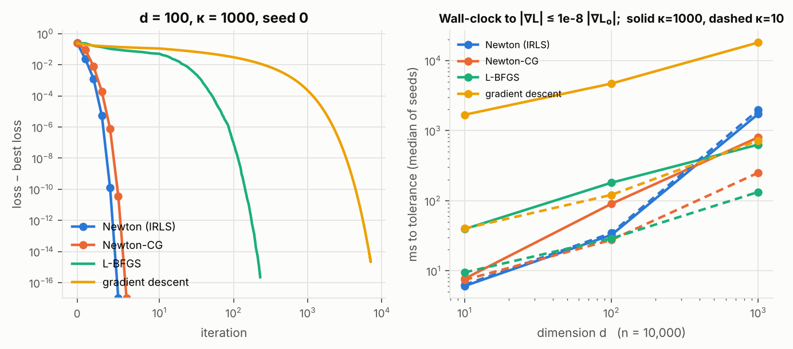
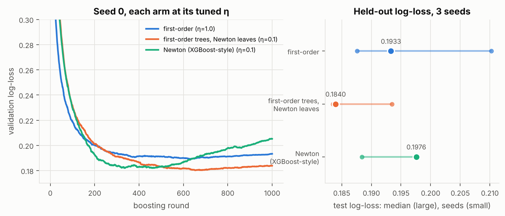

# M1 — Autodiff internals and Newton's method

> **Status:** O1 and O2 done; M1 complete ·
> **Hardware:** CPU, 4 cores, x86_64. No GPU was used, and every wall-clock number is from this CPU ·
> **Data:** [`data/o1-jacobian.json`](data/o1-jacobian.json), [`data/o1-hvp.json`](data/o1-hvp.json), [`data/o1-remat.json`](data/o1-remat.json), [`data/o2-logistic.json`](data/o2-logistic.json), [`data/o2-boosting.json`](data/o2-boosting.json) ·
> **Reproduce:** `uv run python experiments/o1_autodiff/run.py jacobian hvp remat plot` (about 4 minutes); `uv sync --extra boost && uv run python experiments/o2_newton/run.py logistic boosting plot` (about 45 minutes; needs `../ml-ladder` for A1's and A4's data generators)

## O1 — Forward vs reverse mode, Hessian-vector products, rematerialisation

### Question

ml-ladder's B1 left three autodiff ideas as open threads:

- forward mode, for Jacobian-vector products;
- Hessian-vector products, for second-order methods;
- checkpointing, which recomputes activations instead of storing them.

JAX exposes all three as one-line transformations. For each, the textbook makes
a cost claim. Which of those claims hold when the program is compiled by XLA
and run on real hardware?

### The idea

Reverse mode (`vjp`) costs about one backward pass per *output*. Forward mode
(`jvp`) costs one tangent pass per *input*.

So a full Jacobian of $f:\mathbb{R}^n\to\mathbb{R}^m$ should favour forward mode
when $n<m$, and reverse mode when $n>m$.

A Hessian-vector product $Hv$ composes the two modes. It needs no $D\times D$
Hessian and should cost a small constant times one gradient (Pearlmutter, 1994).

Checkpointing (`jax.checkpoint`, also called remat) trades memory for compute:
- **Store less:** keep only some activations from the forward pass.
- **Recompute the rest:** rebuild them during the backward pass.
- **Price:** about one extra forward pass, so $4/3$ the FLOPs if backward costs
  $2\times$ forward.

Every cost here is read two ways:
- **From the compiled XLA program:** its FLOPs (`cost_analysis`) and buffer
  bytes (`memory_analysis`). These are deterministic.
- **From the jaxpr:** `saved_residuals`, which lists what reverse mode keeps
  between the forward and backward passes.

Wall-clock comes third. On a shared 4-core CPU it is the noisiest of the three.

### The math

**Jacobian.** `jacfwd` pushes the $n$ basis tangents through as one batched
`jvp`. `jacrev` pulls the $m$ basis cotangents back through one batched `vjp`.

For a tanh MLP with hidden width $h$, depth $L$, input $n$ and output $m$:

$$\text{FLOPs}(\texttt{jacfwd}) \approx n\,(2hn + 2Lh^2 + 2hm),
\qquad \text{FLOPs}(\texttt{jacrev}) \approx m\,(2hn + 2Lh^2 + 2hm).$$

They are equal exactly at $n=m$. With $nm$ fixed, their ratio is $n/m$ times a
factor that grows with the imbalance.

**HVP, three exact orders.** With $g=\nabla f$:

- forward-over-reverse: $Hv = \partial_\varepsilon\, g(p+\varepsilon v)\big|_0$, as `jvp(grad(f))`;
- reverse-over-reverse: $Hv = \nabla_p\,\langle g(p), v\rangle$, as `grad(vdot(grad(f), v))`;
- reverse-over-forward: $Hv = \nabla_p\,\big(\partial_\varepsilon f(p+\varepsilon v)\big)$, as `grad(jvp(f))`.

**Finite differences.** A step $\varepsilon$ in machine precision $\epsilon_m$
trades truncation error against round-off:

| finite difference | formula | truncation | round-off | best step | best error |
| --- | --- | --- | --- | --- | --- |
| central | $(g(p+\varepsilon v)-g(p-\varepsilon v))/2\varepsilon$ | $O(\varepsilon^2)$ | $O(\epsilon_m/\varepsilon)$ | $\varepsilon^\star\sim\epsilon_m^{1/3}$ | $\epsilon_m^{2/3}$ |
| one-sided | $(g(p+\varepsilon v)-g(p))/\varepsilon$ | $O(\varepsilon)$ | $O(\epsilon_m/\varepsilon)$ | $\varepsilon^\star\sim\epsilon_m^{1/2}$ | $\epsilon_m^{1/2}$ |

In fp32 ($\epsilon_m = 1.19\times10^{-7}$) the predicted best errors are
$2.4\times10^{-5}$ and $3.4\times10^{-4}$.

**Rematerialisation.** For $L$ layers in $k$ segments, segment checkpointing
keeps the $L/k$ boundary activations, plus one segment's $k$ internal
activations during the backward pass. That is minimised at $k=\sqrt{L}$.

### What we measure and why

- **jvp vs vjp.** One function family: a tanh MLP with $h=512$, 4 hidden
  layers, and $nm = 2^{16}$ fixed while $n/m$ is swept from $2^{-8}$ to $2^{8}$.
  - Measured: wall-clock (median of seeds 0–2), compiled FLOPs, and agreement
    between the two Jacobians.
  - Also measured, at $n=m=256$: single `jvp`, `vjp` (input only), `vjp`
    w.r.t. the weights and input, and `linearize`-then-apply, each relative
    to one forward pass. Two batch sizes: 1 and 256.
- **HVP.** The loss is the cross-entropy of an MLP classifier (32 → 128 → 10,
  batch 512; 5,376 parameters), with a random unit direction $v$.
  - Reference: forward-over-reverse in **float64**. It agrees with float64
    reverse-over-reverse to $1.9\times10^{-16}$.
  - Accuracy: the three AD orders in fp32, and both finite differences in fp32
    and fp64, over $\varepsilon = 10^{-8}\dots1$ in half-decade steps.
  - Cost: time, FLOPs and temp memory relative to one gradient, on that MLP
    and on R2's 4M transformer (T = 128, batch 4).
- **Remat**, on two models.
  - **A 12-layer tanh MLP** (512 wide, batch 4096), chosen so that
    activations outweigh the weights. Five arms:
    - no remat;
    - checkpoint every layer;
    - every layer with `dots_saveable`;
    - 4 segments of 3 layers;
    - the whole network as one checkpoint.
  - **The R2 transformer.** Three arms:
    - no remat;
    - per-block checkpoint saving nothing;
    - per-block with `dots_with_no_batch_dims_saveable`.

    The 4M model is timed at T = 256 with 16 sequences. The 25M RoPE model at
    R2's real step (16 × 1024 tokens) is only compiled: it is too slow to time
    on this CPU, and the compiled program's buffer sizes do not need it to run.

### What I built

- **`experiments/o1_autodiff/run.py`**: the three experiments and the
  figures. HVP runs with `jax_enable_x64`; every fp32 problem is drawn in fp64
  and cast, so it is the reference problem rounded. (The same PRNG key gives
  *different numbers* per dtype, and an early run compared against the wrong
  problem because of it.)
- **`src/jaxexp/bench.py`**, three helpers that later experiments reuse:
  - `time_call`: median wall-clock after a warm-up call that also compiles;
  - `compiled_stats`: FLOPs and memory of the compiled program, without
    running it;
  - `residual_stats`: what reverse mode saves, excluding arguments and
    closed-over constants.
- **`jaxexp.transformer.CharTransformer(..., remat=True, policy=...)`**:
  per-block `nnx.remat`, opt-in. R2 needs it (see Results).
- **`src/jaxexp/plotting.py`**: the house figure style.

### Results

**Forward vs reverse mode for full Jacobians.**

| $n$ | $m$ | $n/m$ | `jacfwd` (ms) | `jacrev` (ms) | time fwd/rev | FLOPs fwd/rev |
| --- | --- | --- | --- | --- | --- | --- |
| 16 | 4096 | $2^{-8}$ | 0.75 (0.75–0.81) | 72.04 (66.79–78.62) | 0.010 | 0.004 |
| 64 | 1024 | $2^{-4}$ | 1.13 (1.05–1.15) | 7.94 (7.52–8.36) | 0.140 | 0.063 |
| 128 | 512 | $2^{-2}$ | 1.75 (1.62–1.75) | 4.03 (3.56–4.04) | 0.433 | 0.251 |
| 256 | 256 | $2^{0}$ | 2.16 (2.10–2.40) | 2.06 (2.00–2.28) | 1.052 | 1.000 |
| 512 | 128 | $2^{2}$ | 3.93 (3.59–4.00) | 1.70 (1.62–1.83) | 2.308 | 3.979 |
| 1024 | 64 | $2^{4}$ | 6.93 (6.92–7.75) | 1.18 (1.05–1.30) | 5.866 | 15.786 |
| 4096 | 16 | $2^{8}$ | 76.38 (69.86–78.76) | 1.02 (0.93–1.04) | 74.690 | 241.370 |

The full sweep is in the JSON, with all nine ratios. The two Jacobians agree to
about $1.1\times10^{-6}$ relative.

**The crossover:**
- **In FLOPs:** at exactly $n/m = 1$.
- **In wall-clock:** at $n/m = 2^{-0.115}$, that is 0.92, across seeds
  ($2^{-0.117}$ to $2^{-0.115}$). Forward mode becomes the slower of the two
  slightly before $n = m$.

Away from the crossover, time compresses the FLOP ratio. A 241× FLOP
disadvantage costs 75× in time, and a 252× FLOP advantage buys 97×. The cheap
side sits on a floor of about 1 ms.

**Single products, relative to one forward pass** ($n=m=256$; time as a
median, with the min–max over seeds):

| product | FLOPs | time, batch 1 | time, batch 256 |
| --- | --- | --- | --- |
| `jvp` (primal and tangent) | 2.00× | 1.55× (1.39–1.74) | 2.00× (1.45–2.03) |
| `vjp` w.r.t. input (forward and pullback) | 2.00× | 2.04× (1.91–2.72) | 1.64× (1.17–1.89) |
| `vjp` w.r.t. weights and input | 2.51× (batch 1), 3.00× (batch 256) | 3.69× (3.16–4.01) | 2.41× (1.81–2.69) |
| `linearize` once, then apply | 1.00× | 1.16× (1.15–1.19) | 0.91× (0.63–0.96) |

What these rows show:
- **The textbook cost ratios hold exactly.** The jvp is 2× a forward pass. The
  parameter gradient is 3×: the forward pass, the backward pass to the inputs,
  and the weight-gradient matmuls.
- **The batch-1 weight gradient reads 2.51×, not 3×.** Its weight gradients
  are outer products, and XLA counts one FLOP per output element for those.
- **`linearize` amortises.** The primal is computed once, after which each
  further jvp costs one forward pass.
- **Little is saved for the backward pass.** The input `vjp` keeps 4 tensors:
  8 KiB at batch 1 and 2 MiB at batch 256. They are $1-\tanh^2$, the
  derivative itself, not the activation.

**Hessian-vector products: accuracy.**

| method | precision | best $\varepsilon$ | relative error |
| --- | --- | --- | --- |
| forward-over-reverse | fp32 | — | $2.25\times10^{-7}$ ($2.23$–$2.28$) |
| reverse-over-reverse | fp32 | — | $2.27\times10^{-7}$ ($2.24$–$2.28$) |
| reverse-over-forward | fp32 | — | $2.27\times10^{-7}$ ($2.24$–$2.28$) |
| central difference | fp32 | $3\times10^{-2}$ | $3.9\times10^{-5}$ |
| one-sided difference | fp32 | $3\times10^{-3}$ | $8.0\times10^{-4}$ |
| central difference | fp64 | $3\times10^{-5}$ | $5.8\times10^{-11}$ |
| one-sided difference | fp64 | $3\times10^{-7}$ | $3.2\times10^{-8}$ |

**Hessian-vector products: cost relative to one gradient.**

| method | MLP time | MLP FLOPs | 4M transformer time | 4M FLOPs | 4M temp memory |
| --- | --- | --- | --- | --- | --- |
| forward-over-reverse | 1.66× (1.52–1.79) | 1.89× | **1.81×** (1.80–1.85) | 2.66× | 1.99× |
| reverse-over-reverse | 1.72× (1.68–1.73) | 1.89× | **2.72×** (2.68–2.76) | 2.68× | 2.19× |
| reverse-over-forward | 1.96× (1.70–1.98) | 1.89× | 1.88× (1.79–2.04) | 2.66× | 2.15× |
| central difference, $\varepsilon=10^{-2}$ | 1.31× (1.25–1.54) | 2.00× | 1.42× (1.30–1.49) | 2.13× | 2.02× |

A 4M-transformer gradient takes 133 ms (130–137); an MLP gradient takes 0.4 ms.

**Rematerialisation, 12-layer MLP** (512 wide, batch 4096). "Residuals" is what
the jaxpr saves; "temp" is XLA's compiled scratch memory:

| arm | residuals | temp | FLOPs | time |
| --- | --- | --- | --- | --- |
| no remat | 192 MiB | **104 MiB** | 1.000× | 237 ms (235–239) |
| per layer, save nothing | 96 MiB | **104 MiB** | 1.342× | 1.26× |
| per layer, save matmuls | 192 MiB | 192 MiB | 1.001× | 1.23× |
| 4 segments of 3 layers | 32 MiB | **56 MiB** | 1.342× | 1.10× |
| whole network | 8 MiB | **104 MiB** | 1.342× | 1.15× |

Every arm's gradient is bitwise identical to no remat's.

**Rematerialisation, the R2 transformer:**

| model | arm | residuals | temp | FLOPs | time |
| --- | --- | --- | --- | --- | --- |
| 4M, T = 256, 16 sequences | no remat | 841 MiB | 868 MiB | 1.000× | 732 ms (704–786) |
| | per block, save nothing | 40 MiB | 224 MiB | 1.256× | **0.88×** |
| | per block, save matmuls | 200 MiB | 296 MiB | 1.073× | **0.76×** |
| 25M RoPE, T = 1024, 16 sequences | no remat | 20.2 GiB | **19.7 GiB** | 1.000× | (compiled only) |
| | per block, save nothing | 0.39 GiB | **2.97 GiB** | 1.259× | |
| | per block, save matmuls | 2.39 GiB | **3.91 GiB** | 1.096× | |

**Where the textbook holds, and where it doesn't:**

- **"Choose the mode by the shape of the Jacobian": holds.**
  - The FLOP crossover is at exactly $n=m$, and the time crossover at
    $n/m=0.92$.
  - Wall-clock is less extreme than the FLOP count at both ends.
- **"A jvp costs about 2× a forward pass, a gradient about 3×": holds
  exactly in FLOPs** (2.00× and 3.00×). Wall-clock lands at 1.5–2× and
  2.4–3.7×.
- **"An HVP costs a small constant times a gradient": holds.**
  - It costs 1.9–2.7× in FLOPs and 1.7–2.7× in time.
  - The three exact orders are equally accurate, at fp32 round-off.
  - **They are not equally fast.** On the transformer, reverse-over-reverse
    is 1.5× slower than forward-over-reverse at the same FLOPs, which is why
    forward-over-reverse is the recommended default.
- **"Finite differences lose a third (central) or half (one-sided) of the
  digits": holds**, within 2.4× of the predicted best error:
  - central: $3.9\times10^{-5}$ against $2.4\times10^{-5}$ predicted in fp32,
    and $5.8\times10^{-11}$ against $3.7\times10^{-11}$ in fp64;
  - one-sided: $8.0\times10^{-4}$ against $3.4\times10^{-4}$ in fp32, and
    $3.2\times10^{-8}$ against $1.5\times10^{-8}$ in fp64.

  The best fp32 central step, $3\times10^{-2}$, is 6× the textbook
  $\epsilon_m^{1/3}$, because the optimum also scales with the function. At its
  best step, central FD is **170× less accurate** than any AD order. It is also
  cheaper in time (1.3–1.4× a gradient), since its two gradient calls compile
  into one program.
- **"Checkpointing costs one extra forward pass": holds.** The cost is 1.342×
  the FLOPs, against $4/3$.
- **"Checkpointing saves memory": only for the right granularity.**
  - **Per layer and whole network: no saving on the MLP.** Checkpointing a
    one-op layer keeps its input, and its input is the previous layer's
    output, which no remat kept anyway. Checkpointing the whole network just
    moves the forward pass into the backward pass, where all its activations
    are live again.
  - **Segments:** 4 segments of 3 almost halve the memory (104 → 56 MiB).
    56 MiB is exactly seven 8 MiB activations: the 4 segment boundaries plus
    one segment's 3 layers. No remat holds thirteen.
  - **Save-matmuls on the MLP: worse than no remat** (192 MiB). It keeps the
    pre-activations as well as the outputs.
  - **Transformer blocks are where per-block remat pays.** A block's
    attention and MLP activations are much larger than its input: −74% on
    the 4M model, and −85% on the 25M.

### What surprised me

**R2's step does not fit on a T4 without remat.**
- In fp32 with explicit attention, the 25M RoPE model at 16 × 1024 tokens
  needs **19.7 GiB** of scratch memory. A T4 has 16 GB.
- Most of it is attention. One layer's probabilities alone are
  16 × 8 × 1024² × 4 B = 512 MiB, and every layer keeps several such tensors.
- PyTorch fit the same step on the T4 through SDPA's memory-efficient kernel
  and fp16. JAX on the T4 has no cuDNN flash attention: that needs sm_80+.
- So R2 should use per-block remat with the save-matmuls policy: 3.9 GiB at
  1.10× the FLOPs. Halving to fp16 is the other lever.
- This is the CPU compiler's buffer assignment. The number to trust is the
  same `memory_analysis` on the T4.

**Remat made the transformer *faster* on CPU.**
- Per-block remat cut the 4M model's step to 0.88× (save nothing) and 0.76×
  (save matmuls), although it does 1.26× and 1.07× the FLOPs. Every seed
  agreed.
- A plausible reading: the extra FLOPs are cheaper than streaming 868 MiB of
  saved activations through memory and caches.
- On the MLP, where the recomputed op is a single matmul, remat cost 1.10–1.26×
  as expected.
- So "remat trades speed for memory" is a GPU-era rule of thumb. On a
  bandwidth-starved CPU it can be a free win.

**XLA hides activations in gradient buffers.**
- On a 12-layer MLP with batch 512, the gradient program needed **4 MiB** of
  scratch memory, though reverse mode saves 48 MiB.
- Asking only for the input gradient drops the outputs from 48 MiB to 2 MiB.
  Scratch memory then rises to **24 MiB**: the 12 activations of 2 MiB each.
- XLA had been storing activations in weight-gradient output buffers that
  were not yet written.
- It also keeps only the tanh outputs, half of what the jaxpr saves. It
  recomputes $1-\tanh^2$ inside the backward fusion: XLA remats on its own.
- Hence the rule: **read memory from the compiled program, not from the
  jaxpr.**
  - They disagree in both directions. On the MLP's whole-network arm the
    jaxpr saves 8 MiB, but the program uses 104 MiB.
  - The jaxpr shows what crosses from the forward to the backward pass. The
    compiled program shows what is live at once.

**`peak_memory_in_bytes` is not peak memory on CPU.** It reports arguments
plus outputs only, and was identical for every remat arm. The numbers above use
`temp_size_in_bytes`, and arguments plus outputs plus temp for the total.

**Two artefacts would have corrupted the tables.**
- `x @ w.T` makes `saved_residuals` count every transposed weight as a saved
  tensor, though XLA folds the transpose into the matmul. Weights that a
  function closes over show up as "from a constant". Both are excluded now.
- Under x64, `jax.random.normal(key, shape, float32)` and the same call in
  float64 draw *different* numbers, not the same numbers rounded. The first
  HVP run therefore compared fp32 results against a different problem's
  reference.

### Open threads

- **The same memory analysis on the T4**, before R2 starts. GPU buffer
  assignment differs from CPU, and the fp16 step changes everything by about
  2×. It is a compile-only check, so it costs seconds of GPU time.
- **Chunked attention instead of remat**, for R2 on sm_75. Score the
  sequence in key blocks, as flash attention does, written in `jnp`. Pallas
  is out on a T4. Compare its memory and time against per-block remat.
- **A Newton step that uses these HVPs.** O2 is next. Truncated Newton (CG on
  $Hv$) for logistic regression uses forward-over-reverse directly, and the
  cost table above prices each inner iteration at about 1.7 gradients.
- **Remat speedups on GPU.** Whether the CPU's "remat is faster" survives on
  the T4, where activations live in 300 GB/s HBM rather than in a CPU's
  memory system.

## O2 — Newton's method where ml-ladder used first order

### Question

ml-ladder left two Newton steps unbuilt.
- **A1** trained logistic regression by gradient descent only. Its open
  threads proposed IRLS, "to watch second-order information pay off".
- **A4** matched XGBoost to $6\times10^{-6}$ on squared loss, where $h\equiv1$
  and the Newton leaf is just the mean residual. It left "the Newton step for a
  loss where $h \not\equiv 1$, e.g. log-loss" as the point "at which the
  second-order version stops being equivalent and starts being better".

With `jax.hessian`, both are a few lines. Does second-order information pay
off, in iterations, wall-clock, and held-out loss? And can autodiff supply
XGBoost's $g$ and $h$ for any loss, exactly?

### The idea

**Logistic regression.** Newton's step $w \leftarrow w - H^{-1}\nabla L$ uses
the curvature to rescale every direction. It converges quadratically near the
optimum, and its iteration count does not depend on how badly the problem is
conditioned. Gradient descent's count grows with the condition number $\kappa$.
The price is the Hessian: $O(nd^2)$ to form and $O(d^3)$ to solve.

Two methods sit between the extremes:
- **Truncated Newton-CG** solves $Hp=-g$ by conjugate gradients, on O1's
  Hessian-vector products. It never forms $H$, and pays $O(nd)$ per
  inner step.
- **L-BFGS** builds a curvature estimate from recent gradient differences.

**Boosting.** Each round fits a tree to a second-order expansion of the loss
around the current scores, using per-sample $g_i = \partial_F \ell$ and
$h_i = \partial_F^2 \ell$. The leaf value is then the Newton step for that
leaf. The splits are chosen by the same quadratic's gain.

Nothing in the tree depends on which loss it was. So if autodiff provides $g$
and $h$, one implementation serves every smooth loss.

### The math

**Logistic regression.** With $p = \sigma(Xw)$ and $S = \operatorname{diag}(p(1-p))$:

$$L(w) = \tfrac{1}{n}\sum_i \big(\log(1+e^{x_i^\top w}) - y_i x_i^\top w\big) + \tfrac{\lambda}{2}\lVert w\rVert^2,
\qquad \nabla L = \tfrac{1}{n}X^\top(p-y) + \lambda w, \qquad H = \tfrac{1}{n}X^\top S X + \lambda I .$$

The textbook calls the Newton iteration on this IRLS. Gradient descent with
step $c/L$, where $L \ge \lambda_{\max}(H)$, needs
$O(\kappa \log(1/\epsilon))$ iterations. L-BFGS behaves roughly like
$O(\sqrt{\kappa})$ in practice, and Newton like $O(\log\log(1/\epsilon))$ once
close.

**Newton boosting** (as in O1's notation and XGBoost's paper). For a leaf $j$
with samples $I_j$:

$$w_j^\star = -\eta\,\frac{\sum_{i\in I_j} g_i}{\sum_{i\in I_j} h_i + \lambda},
\qquad \text{gain} = \frac{G_L^2}{H_L+\lambda} + \frac{G_R^2}{H_R+\lambda} - \frac{G^2}{H+\lambda}.$$

Three arms differ only in which $h$ goes where:
- **first-order**: $h\equiv1$ everywhere. Least squares on $-g$, leaves at the
  mean negative gradient.
- **first-order trees with Newton leaves**: $h\equiv1$ to choose splits, the
  true $h$ in the leaves.
- **full Newton**: the true $h$ in both, as XGBoost does.

For log-loss, $g = p - y$ and $h = p(1-p) \le \tfrac14$. A first-order leaf is
therefore at most 1 in size. A Newton leaf divides by at most $\tfrac14$, so it
takes steps at least 4× larger at the same $\eta$.

### What we measure and why

- **Logistic regression** (float64, tolerance $\lVert\nabla L\rVert \le 10^{-8}\lVert\nabla L_0\rVert$).
  - **Data:**
    - A1's data generator and settings: two blobs, 600 samples, std 2.2,
      box $(-3,3)$, standardised, with 450 used for training and $\lambda=0$.
      This is a fresh draw per seed. A1's exact draw came from an RNG stream
      its regression half had already consumed, so it is not reproducible
      separately.
    - A synthetic sweep: $n = 10{,}000$ Gaussian features with condition
      number $\kappa\in\{10, 1000\}$ (random rotation),
      $d\in\{10, 100, 1000\}$, labels from a logistic model, $\lambda = 10^{-4}$.
  - **Measured:** iterations; wall-clock of the compiled solver (the first run,
    which includes compilation, is recorded separately); gradients, Hessians
    and HVPs used; final suboptimality.
  - **Also:** the cost of one `jax.hessian` against the hand-written
    $X^\top SX$.
  - **Gradient descent is tuned per seed.** Its step $c/L$ uses the best
    $c \in \{1,2,4,\dots,64\}$. A step tuned on one seed sat on another seed's
    stability edge: it never converged on seeds 1 and 2 of A1.
- **Boosting.**
  - **(1) Parity with XGBoost 3.4.1**: exact updater, depth 3, $\eta=0.3$,
    $\lambda=1$, `min_child_weight` 1, 100 rounds, one thread. Data: A4's
    Friedman #1, 2,000 samples (1,500 train). Three losses:
    - log-loss on the median-binarised target, against XGBoost's own
      `binary:logistic`;
    - pseudo-Huber with $\delta = 1$, against `reg:pseudohubererror`;
    - log-cosh, which XGBoost has no formula for, passed to it as a custom
      objective computed by the same autodiff.

    Compared: the tree structure (feature and threshold of every split), leaf
    values, and held-out margins.
  - **(2) Does the Newton step pay?** Log-loss on Friedman #1 binarised at the
    training median, 5,000 samples split 2,812 / 938 / 1,250.
    - $\eta \in \{0.03, 0.1, 0.3, 1, 2, 4, 8\}$ and the number of rounds (up to
      1,000) are chosen on the validation split for each arm and seed.
    - A4's original grid (0.03–1, 300 rounds) left first-order on its edge, so
      it was widened. No choice lands on the edge of the final grid.
    - $\lambda$ and `min_child_weight` stay at XGBoost's defaults (1 and 1) for
      every arm.

### What I built

- **`src/jaxexp/newton.py`**: four solvers, each one `lax.while_loop`
  compiled whole:
  - Newton: `jax.hessian`, Cholesky solve, Armijo backtracking;
  - Newton-CG: CG on `jvp(grad)` HVPs, with the Eisenstat–Walker forcing term;
  - L-BFGS: `optax.lbfgs` with its zoom line search;
  - gradient descent.

  Each returns its iterate, its work counts and its loss history.
- **`src/jaxexp/boosting.py`**: `derivatives(loss)` gives per-sample $g, h$
  from `jax.grad` applied twice and vmapped. The tree grower follows XGBoost's
  exact updater:
  - float32 gradient pairs summed in float64;
  - float32 features, with splits at the float32 midpoint and `x < threshold`
    going left;
  - `min_child_weight` on Hessian sums;
  - a minimum gain of $10^{-6}$;
  - the lower feature index wins ties.

  `hessian="ones"` and `"leaves"` give the other two arms. Tree growth is
  NumPy, not JAX: it is discrete and data-dependent.
- **`experiments/o2_newton/run.py`**: both experiments and the figures. It
  checkpoints each (configuration, seed) in `runs/`, after a container restart
  killed one run partway.
- **`tests/test_o2_newton.py`**, 7 tests:
  - `jax.hessian` equals IRLS;
  - all four solvers reach the same optimum;
  - autodiff $g, h$ match closed forms for three losses;
  - squared loss gives a regression tree, ml-ladder A4's identity;
  - 10 rounds match XGBoost to $10^{-5}$.

### Results

**Logistic regression, iterations to tolerance** (median and range over seeds;
all 84 runs converged):

| problem | Newton | Newton-CG (HVPs) | L-BFGS | gradient descent |
| --- | --- | --- | --- | --- |
| A1 blobs, $d=2$ | 5 (4–6) | 5 (9 HVPs) | 10 (8–11) | 23 (20–27) |
| $d=10$, $\kappa=10$ | 5 (5–6) | 6 (30) | 23 (22–23) | 162 (108–175) |
| $d=100$, $\kappa=10$ | 5 (5–6) | 6 (38) | 32 (30–33) | 192 (157–206) |
| $d=1000$, $\kappa=10$ | 6 | 7 (64) | 41 (40–42) | 296 (291–297) |
| $d=10$, $\kappa=1000$ | 5 | 6 (46) | 99 (94–109) | 6,839 (5,790–7,533) |
| $d=100$, $\kappa=1000$ | 5 | 6 (194) | 230 (228–234) | 7,072 (6,592–7,092) |
| $d=1000$, $\kappa=1000$ | 5 | 7 (364) | 259 (256–260) | 8,170 (8,139–8,212) |

**Wall-clock to tolerance** (ms, median and range; compiled, excluding compilation):

| problem | Newton | Newton-CG | L-BFGS | gradient descent |
| --- | --- | --- | --- | --- |
| A1 blobs, $d=2$ | 0.5 (0.3–0.6) | 0.3 (0.3–0.5) | 0.7 (0.7–0.8) | 0.7 (0.7–0.8) |
| $d=10$, $\kappa=10$ | **6.3** (6.1–7.3) | 7.4 (6.8–7.4) | 9.5 (9.0–10.4) | 40.2 (32.1–43.9) |
| $d=100$, $\kappa=10$ | 34.6 (33.4–38.0) | **27.6** (26.7–30.7) | 28.9 (27.4–29.4) | 121 (104–131) |
| $d=1000$, $\kappa=10$ | 1,965 (1,932–2,056) | 251 (235–254) | **133** (131–149) | 722 (643–792) |
| $d=10$, $\kappa=1000$ | **6.1** (5.7–6.8) | 7.7 (7.2–9.7) | 39.4 (37.7–39.5) | 1,686 (1,416–1,943) |
| $d=100$, $\kappa=1000$ | **32.5** (31.4–32.6) | 90.4 (84.0–118) | 181 (179–189) | 4,699 (4,646–4,753) |
| $d=1000$, $\kappa=1000$ | 1,730 (1,595–1,740) | 803 (793–816) | **632** (600–638) | 18,112 (18,098–18,486) |

Notes on these tables:
- **Same optimum.** Every solver reached the same loss to within
  $6\times10^{-15}$.
- **Tuned step.** Gradient descent's best step was $2/L$ on every synthetic
  problem. On A1 it was $4/L$, $1/L$ and $2/L$ for the three seeds.
- **One Hessian costs:** about 0.34 s at $d = 1000$. `jax.hessian` matches the
  hand-written $X^\top SX$ to $3\times10^{-16}$. It spends 2.0–2.75× its FLOPs
  and 1.2–1.8× its time, because forward-over-reverse does not exploit
  symmetry.

**Boosting: parity with XGBoost** (100 rounds × 3 seeds per loss; median and range):

| loss | trees identical in structure | max leaf difference | max held-out margin difference | margins up to |
| --- | --- | --- | --- | --- |
| log-loss (`binary:logistic`) | **300 / 300** | $6.5\times10^{-8}$ (5.9e-8–8.2e-8) | $6.0\times10^{-6}$ (4.9e-6–6.4e-6) | 14.6 |
| pseudo-Huber (`reg:pseudohubererror`) | **300 / 300** | $4.3\times10^{-6}$ (3.7e-6–1.3e-5) | $1.3\times10^{-5}$ (1.0e-5–1.4e-5) | 26.7 |
| log-cosh (custom objective) | **299 / 300** | $1.4\times10^{-5}$ (4.1e-6–8.7e-5) | $6.0\times10^{-5}$ (1.2e-5–0.25) | 27.5 |

- **The one log-cosh tree that differs** is tree 92 of seed 0. One node splits
  on the same feature at a different threshold: 0.3676 here, 0.3777 in XGBoost.
  The two thresholds' gains are equal to $4.4\times10^{-11}$ relative, so it is
  a tie that the two summation orders break differently. Every later tree
  inherits the difference, which is where seed 0's 0.25 comes from.
- **Speed:** my NumPy grower takes 0.76–0.85 s per 100 trees. That is 6.9×
  XGBoost's C++ on the built-in objectives, and 3.1× when XGBoost has to call
  back into Python for a custom objective.

**Boosting: does the Newton step pay?** (log-loss; $\eta$ and rounds tuned per
arm and seed on validation)

| arm | test log-loss | per seed, vs first-order | test accuracy | tuned $\eta$ | rounds |
| --- | --- | --- | --- | --- | --- |
| first-order | 0.1933 (0.1876–0.2102) | — | 0.910 (0.907–0.911) | 1, 1, 1 | 629, 631, 445 |
| first-order trees, Newton leaves | **0.1840** (0.1835–0.1935) | −0.0168, −0.0098, −0.0036 | 0.910 (0.910–0.914) | 0.1, 0.1, 0.3 | 653, 628, 159 |
| full Newton (XGBoost-style) | 0.1976 (0.1884–0.1976) | −0.0126, +0.0043, +0.0008 | 0.910 (0.907–0.914) | 0.1, 0.3, 0.3 | 460, 111, 100 |

**What the boosting table shows:**
- **Accuracy can't separate the arms.** Every arm is within 0.007 of every
  other, less than one standard error on 1,250 test samples (0.008).
- **Newton leaves win on every seed.** They beat first-order on log-loss by
  0.004 to 0.017.
- **Full Newton does not.** It beats first-order on seed 0 only, and is worse
  on seeds 1 and 2.

**Where the second-order claims hold, and where they don't:**
- **"Newton's iteration count does not depend on conditioning": holds
  exactly.**
  - Newton takes 4–6 iterations on every problem, from $\kappa=10$ to 1,000
    and $d=2$ to 1,000.
  - Gradient descent's count grows 28–42× with $\kappa$; L-BFGS's grows 4–7×.
  - Newton-CG's outer count stays at 6–7. Conditioning moves into its inner
    CG instead: 30 → 46, 38 → 194 and 64 → 364 HVPs as $\kappa$ rises.
- **"…so it is faster": holds until the Hessian costs more than the
  iterations it saves.**
  - Up to $d=100$, full Newton is fastest or close to it: up to **278×**
    faster than tuned gradient descent at $d=10$, $\kappa=1000$, and 145× at
    $d=100$.
  - At $d=1000$, each Hessian costs about 0.34 s. L-BFGS is fastest there
    (2.7–15× ahead of Newton), and Newton-CG second.
  - Gradient descent is never fastest, and at $d=1000$, $\kappa=1000$ it is
    29× slower than L-BFGS.
- **"Newton leaves pay off where $h\not\equiv1$" (A4's thread): holds for the
  leaves.** Newton leaves on first-order trees beat tuned first-order boosting
  on all three seeds (median 0.1840 against 0.1933).
- **The Hessian-weighted *split* criterion did not help here.** Full
  XGBoost-style Newton (median 0.1976) was no better than first-order. It does
  reach its best validation loss in fewer rounds (100–460, against 445–631),
  and then overfits faster (see the figure).

### What surprised me

**Second-order split choice hurt, though second-order leaves helped.**
- The split gain weights each sample by $h_i = p_i(1-p_i)$.
- With `min_child_weight` = 1 counted in $h$, a leaf needs at least 4 samples
  when $p=\tfrac12$, and far more where the model is confident.
- So the Newton tree spends its splits on samples that are still uncertain,
  and its leaves take larger steps there.
- That fits the fast-then-overfit curve. It is a hypothesis, not a
  measurement: $\lambda$ and `min_child_weight` were held at XGBoost's
  defaults, and a fair test tunes them per arm.

**Autodiff reproduces a C++ library's trees to the threshold.**
- XGBoost's hand-written log-loss and pseudo-Huber derivatives, and its
  split search, came out identical in 600 of 600 trees, from `jax.grad`
  applied twice and 100 lines of NumPy.
- It took conventions no paper states:
  - float32 gradient pairs summed in float64;
  - float32 midpoints for thresholds;
  - `min_child_weight` counted in Hessian units;
  - XGBoost's reported gain has no factor of ½.

**Matching float32 *margins* made parity worse, not better.**
- XGBoost keeps its running predictions in float32. Doing the same here
  dropped pseudo-Huber parity from 300/300 to 295/300.
- XGBoost computes its built-in $g, h$ in float32 arithmetic, and neither
  margin precision reproduces that. Near-ties break by rounding either way.
- float64 margins match more trees (899 against 894 of 900), so they are the
  default.

**A tuned baseline can be tuned onto a cliff.**
- Gradient descent's best step on A1 seed 0 was $2/L$, the edge of stability
  for the worst-case curvature bound.
- It converged on that seed (23 iterations), and oscillated for 100,000
  iterations on seeds 1 and 2.
- Tuning per seed fixed it: the best steps were $4/L$, $1/L$ and $2/L$.
- Also, steps that are too large oscillate rather than diverge, so a tuning
  sweep should try small steps first and cap the rest.

### Open threads

- **Tune $\lambda$ and `min_child_weight` per boosting arm.** The test of the
  hypothesis above is whether full Newton catches up once its regularisation
  is tuned, or whether Hessian-weighted splits really are worse on this data.
- **Exploit symmetry in `jax.hessian`.** It spends 2× the FLOPs of
  $X^\top SX$. A symmetric Hessian, or a Gauss–Newton form via
  `jax.linearize`, is the obvious fix at large $d$.
- **Precondition Newton-CG**, for example with the diagonal of $H$. Its HVP
  count is the only part that grows with $\kappa$.
- **Histogram-binned boosting in JAX**, so tree growth itself compiles. This
  would also answer A4's other thread, about where XGBoost's speed comes from.
