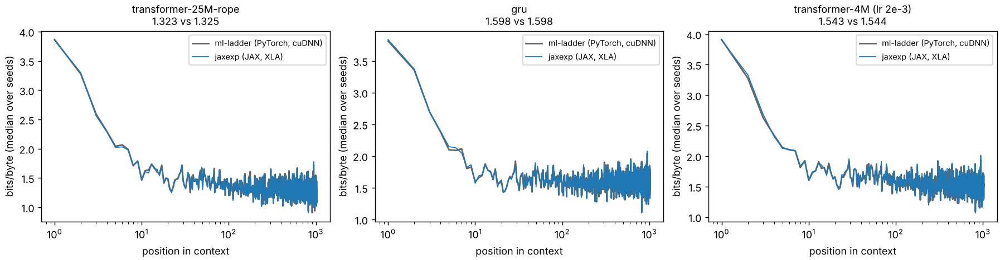

# M2 — enwik8 and the copy task in JAX (R2, R3)

> **Status:** done (R2 and R3) ·
> **Hardware:** Kaggle T4 ×2 (sm_75, one job per GPU), JAX 0.11.1 on the Kaggle image. R3's fused-attention transformer ran on a Colab T4 (same JAX, Flax pinned to Kaggle's 0.12.10), because its Kaggle kernel sat queued for over 20 minutes. Parity checks on CPU (4 cores) ·
> **Data:** [`data/r2-summary.json`](data/r2-summary.json) (every number below), [`data/r2/`](data/r2/) (one JSON and log per run), [`data/r2-calibrate/`](data/r2-calibrate/), [`data/r2-parity.json`](data/r2-parity.json); ml-ladder's references from its `docs/writeups/data/c-gpu*.json` ·
> **Reproduce:** `tools/kaggle/package_source.sh`, then `uv run python tools/kaggle/push_r2.py <preset> --push` for `calibrate`, `calibrate-fused`, `r2`, `r2-fused`, `r3`, `r3-s1`, `r3-s1b` (the `r3-fused` preset ran on Colab instead, as `run.py --studies copy --copy-models transformer-4M --seeds 0 1 2 --amp --attention fused`); then `uv run python experiments/r2_enwik8/analyze.py`. CPU parity: `uv run --extra torch python experiments/r2_enwik8/parity.py`

## Question

Do ml-ladder's Part C numbers reproduce in a second framework? On the same
GPU, with the same protocol, does a JAX port land on the PyTorch numbers?
And how do XLA's fusion and `lax.scan` change the cost?

The arms are PLAN.md's:
- the 25M RoPE transformer at T=1024 (target 1.325 bits/byte);
- the 2×592 GRU written as `lax.scan` (target 1.598; cuDNN ran 182k tokens/s);
- the 4M transformer at lr 2e-3 (target 1.544);
- R3, the copy task: the transformer should copy 512 symbols back, and the LSTM
  should fail at 128.

## The idea

**Make the comparison as tight as a comparison across frameworks can be.**
Each run here starts from *ml-ladder's own initial weights*. Its PyTorch
model is built with the same seed and ported in (`--init torch`). Training
then sees *the same batches*, drawn by the same NumPy RNG calls. So seed $s$
here is the same experiment as ml-ladder's seed $s$, and the two differ only
in the arithmetic: XLA against cuDNN and cuBLAS, and the fp16 handling.
Comparing the runs seed by seed is then a stronger test than comparing
medians.

**Check that equality on CPU before spending GPU hours.** Sixty steps of
ml-ladder's own `train()` and of `jaxexp.train` must agree to round-off,
before any T4 is involved.

**Measure on the GPU before sizing the runs.** A 5-minute calibration kernel
measures compiled memory and throughput on the T4. CPU numbers turned out not
to transfer.

## The math

The protocol is ml-ladder's `c_context_scaling.py`:
- **Optimiser:** AdamW with $\beta = (0.9, 0.95)$, $\epsilon = 10^{-8}$, and
  global-norm clipping at 1.0.
- **Learning rate:** linear warmup over the first 5% of steps, then cosine
  decay to 10% of the peak.
- **Budget:** 12,000 steps of 16 × 1024 bytes (196.6M tokens), then
  per-position cross-entropy on 262,144 validation bytes.
- **Mixed precision.** PyTorch's fp16 autocast has no JAX counterpart, so the
  split is explicit:
  - in fp16: matmul inputs (the `compute_dtype`);
  - in fp32: LayerNorm, softmax, RoPE, the residual stream, the gates of the
    recurrences, and the loss.
- **Dynamic loss scaling, as GradScaler does it:**
  - start at $2^{16}$;
  - multiply by 2 after 2,000 finite steps;
  - on any non-finite gradient, skip the step and multiply by 0.5.

**Attention.** ml-ladder routes every transformer through PyTorch's SDPA, which
computes $\mathrm{softmax}(QK^\top/\sqrt d + M)V$ with fp16 inputs and fp32
accumulation of the scores. Two JAX paths compute the same function:
- `jax.nn.dot_product_attention` ("fused") accumulates the scores in fp32;
- the explicit einsum path *did not* until this milestone. With fp16 inputs,
  its score matrix came out of the matmul in fp16 and was rounded before the
  fp32 softmax. The absolute error is about $|s| \cdot 2^{-11}$, which is
  negligible for diffuse attention and about 0.02 at $|s| \approx 50$.

## What we measure and why

- **Bits/byte, per seed and as median (min–max).** Paired with ml-ladder's
  same-seed run, since both start from identical weights and batches.
- **Loss by position.** The median over seeds at each of the 1,024 positions,
  against ml-ladder's recorded curve. A framework difference in masking or
  positions would show up here first.
- **Cost:** steady-state tokens per second, compile time, and peak device
  memory, against the recorded PyTorch runs on the same T4 type.
- **fp16 health:** skipped steps and the final loss scale.
- **R3:** second-half accuracy on 512 test sequences, for n = 32, 128 and 512,
  seeds 0–2. A failed n=512 seed got two rounds of controls (below).

## What I built

- **`jaxexp.text`:**
  - enwik8, SHA-256 checked, with ml-ladder's split (90M train, the next 5M
    validation);
  - its batch sampler, byte for byte;
  - validation windows;
  - the copy task.
- **`jaxexp.recurrent`:** GRU, LSTM and Elman RNN in PyTorch's equations, as
  `lax.scan`. Parameters are keyed by `state_dict` names, so ml-ladder's
  initial weights load without renaming. The input projection runs once over
  the whole sequence; only the recurrent matmul is inside the scan.
- **`jaxexp.train`:**
  - ml-ladder's schedule (verbatim);
  - AdamW with clipping (`optax`, the learning rate injected per step);
  - fp16 compute with loss scaling;
  - a step that is skipped on overflow.
- **`experiments/r2_enwik8/`:**
  - `run.py`, which mirrors ml-ladder's CLI and JSON fields (`memory`,
    `enwik8` and `copy` studies);
  - `parity.py`, the CPU check against ml-ladder's own `train()`;
  - `analyze.py`.
- **`tools/kaggle/`:**
  - the source travels as a private dataset (`git archive` of both repos);
  - kernels run one job per T4;
  - `push_r2.py` holds the presets.

  Kaggle unpacks uploaded tarballs, so the kernel finds each repo by a marker
  file.
- **A fix in `jaxexp.transformer`.** Explicit attention now accumulates its
  scores in fp32 (`preferred_element_type`), and `run.py` defaults to fused
  attention, matching ml-ladder's SDPA. In fp16, the two paths now agree bit
  for bit on CPU. A test with sharp attention catches the old path at 2.2%.

## Results

### Parity on CPU, before any GPU

12 configurations (GRU, LSTM, learned-position and RoPE transformers; seeds 0–2),
60 steps each, ml-ladder's `train()` against `jaxexp.train` from the same
weights and batches, fp32:

- the training loss agrees to $5.9\times10^{-7}$ relative, at every step;
- the final parameters agree to $1.8\times10^{-6}$;
- validation bits/byte agrees to 6–7 significant digits.

### Calibration on the T4

| 25M RoPE step, T=1024, batch 16 | XLA temp memory |
| --- | --- |
| fp32, explicit attention | 10.13 GiB |
| fp16, explicit (fp16 scores) | 6.85 GiB |
| fp16, fused (fp32 scores) | 9.00 GiB |
| fp16, explicit, per-block remat | 2.28 GiB |

XLA's *CPU* compiler had put the fp32 step at 19.7 GiB (M1, O1). On the GPU
the same program needs about half that. The remat that O1 judged necessary is
not needed, so R2 runs without it.

### R2: every arm lands on ml-ladder's number

| arm (12,000 steps, T=1024) | ml-ladder bits/byte | JAX bits/byte | per-seed difference (s0, s1, s2) |
| --- | --- | --- | --- |
| 25M RoPE, lr 6e-4 | 1.3251 (1.3220–1.3320) | **1.3226** (1.3215–1.3322) | +0.0002, −0.0006, −0.0024 |
| GRU 2×592, lr 2e-3 | 1.5982 (1.5972–1.5987) | **1.5979** (1.5966–1.5989) | +0.0007, +0.0002, −0.0016 |
| 4M, lr 2e-3 | 1.5437 (1.5385–1.5547) | **1.5435** (1.5388–1.5585) | +0.0038, −0.0002, +0.0003 |
| *25M RoPE, explicit, fp16 scores* | | *1.3250 (1.3234–1.3339)* | *+0.0019, +0.0014, −0.0001* |
| *4M, explicit, fp16 scores* | | *1.5421 (1.5371–1.5601)* | *+0.0054, −0.0016, −0.0014* |

- **Every pair is within 0.006 bits/byte**, and 13 of 15 within 0.003. ml-ladder's
  own seed range is 0.010 for RoPE and 0.016 for the 4M. Each median lands
  within 0.0025 of ml-ladder's.
- **The curves agree position by position.** Averaged over positions 16–255,
  the medians differ by at most 0.004 bits/byte; over 256–1023, by at most
  0.001. Single positions differ by up to 0.094, which is sampling noise:
  each position is scored on 256 windows.
- **fp16 was healthy.** At most 3 of 12,000 steps were skipped per run. The
  final loss scale was $2^{17}$ to $2^{22}$.
- **The fp16 score rounding is invisible here.** The explicit arms land
  inside the same ranges, so on enwik8 the rounding costs nothing measurable.
  It mattered on the copy task (below).

### Cost: XLA against PyTorch on the same T4

| arm | JAX tokens/s | PyTorch tokens/s | JAX peak memory | PyTorch peak | compile |
| --- | --- | --- | --- | --- | --- |
| 25M RoPE, fused | 34.4k | 43.9k | 9.9 GB | 3.2 GB | 16 s |
| 25M RoPE, explicit, fp16 scores | 46.8k | | 7.7 GB | | 15 s |
| GRU (`lax.scan` against cuDNN) | 80.7k | 179.6k | 1.2 GB | 0.7 GB | 3 s |
| 4M, fused | 121.9k | 231.4k | 3.1 GB | 0.9 GB | 7 s |
| 4M, explicit, fp16 scores | 161.2k | | 2.3 GB | | 7 s |

*Medians over 3 seeds. The PyTorch figures are ml-ladder's recorded runs on the
same T4 type (fp16 autocast, SDPA, cuDNN).*

- **`lax.scan` runs at 0.45× cuDNN.** The scan issues one small matmul per
  step; cuDNN fuses the whole sequence.
- **XLA's attention materialises the T×T scores; SDPA on the T4 does not.**
  That accounts for the 3× memory gap. How much of the speed gap it explains
  is not measured. On the T4, `jax.nn.dot_product_attention` lowers to XLA's
  own implementation, not a flash kernel. JAX's cuDNN attention targets newer
  GPUs (not tried here), and Pallas doesn't run on a T4 (CLAUDE.md).
- **The explicit path with fp16 scores beats PyTorch** on the 25M model
  (46.8k against 43.9k): fp16 scores halve the score matrix's memory
  traffic. The fixed explicit path (fp32 scores) computes the same numbers
  as the fused one. Its GPU speed is not measured; expect the fused path's.

### R3: the copy task

| second-half accuracy | n=32 | n=128 | n=512 |
| --- | --- | --- | --- |
| LSTM, ml-ladder | 0.903 (0.865–0.912) | 0.031 (chance) | 0.031 |
| LSTM, JAX | 0.893 (0.864–0.910) | 0.031 | 0.031 |
| transformer 4M, ml-ladder | 1.000 | 1.000 | 0.999 (0.917–1.000) |
| transformer 4M, JAX, fused (Colab T4) | 1.000 | 1.000 | **1.000** (0.981–1.000) |
| *transformer 4M, JAX, explicit, fp16 scores* | *1.000* | *1.000* | *0.997 (0.273–1.000)* |

Both of ml-ladder's claims hold:
- **The transformer copies 512 symbols.** With fused attention, all three
  seeds do: 0.981, 1.000 and 1.000, against ml-ladder's 0.917, 1.000 and
  0.999.
- **The LSTM fails at 128.** It reproduces per seed at n=32 (0.910 / 0.893 /
  0.864, against 0.912 / 0.903 / 0.865) and is at chance from n=128 on.

**The one miss, and what it found.** In the first R3 kernel, the
explicit-attention transformer (fp16 scores) reached only 0.273 on seed 1 at
n=512, where ml-ladder has 1.000. Its loss was still on the plateau at step
750 (3.45, against 2.99 and 3.20 for seeds 0 and 2). Controls on that one
configuration:

| seed 1, n=512, 1,500 steps | runs | loss at step 750 | accuracy |
| --- | --- | --- | --- |
| fp16, explicit (fp16 scores) | 3 | 3.40–3.46 | 0.144, 0.273, 0.579 |
| fp32, explicit | 3 | 2.68–2.70 | 0.998–1.000 |
| fp16, fused (fp32 scores) | 3 | 2.70–2.85 | 1.000 ×3 |
| *seed 0, fp16, explicit (repeat)* | 1 | 2.72 | 1.000 |

- **XLA on the GPU is not run-to-run deterministic.** Identical runs from
  identical weights and batches agree to step 375, then diverge (0.14, 0.27,
  0.58).
- **The lag is systematic anyway.** Three of three fp16-score runs stay on the
  plateau. Six of six runs with fp32 scores leave it by step 750. So does the
  seventh, R3's fused rerun on Colab (2.68 at step 750, 1.000 at the end).
- **That is why ml-ladder's protocol choice (SDPA) matters, and why the
  explicit path was fixed.** Copying 512 symbols needs attention sharp enough
  that a rounding of about 0.02 in the scores slows the transition. With 1,500 steps,
  the transition sits right at the edge of the budget: ml-ladder's own seed 0
  reached only 0.917.

## What surprised me

**The seed-for-seed agreement.** Two frameworks, two fp16 schemes, and two
attention implementations give fifteen 12,000-step runs. Each lands within
0.006 bits/byte of its PyTorch twin, and most within 0.002. Training on
enwik8 at this scale is far less chaotic than the copy task's plateau. The
same initial weights and batches give the same function, to three decimals.

**A precision bug that only one task could see.** Rounding attention scores
to fp16 left enwik8 untouched: all six explicit runs are inside the reference
ranges. On the copy task, seeds 0 and 2 still copied 512 symbols. But it
reliably delayed seed 1's escape from the plateau.
Nondeterminism made it look like noise at first. It took repeats of *both*
precisions to see that one arm was 0/3 and the other 6/6.

**CPU memory numbers mislead about GPU programs.** XLA's CPU compiler put the
25M step at 19.7 GiB and implied remat was mandatory. The GPU compiler needs
10.1 GiB in fp32 and 6.85 GiB in fp16. M1 had flagged this to be confirmed on
the T4, and it was the first thing the calibration kernel overturned.

**JAX loses on speed here, by a hardware accident.** The T4 is too old for
cuDNN's fused attention and for Pallas, so XLA's attention materialises the
score matrix. On sm_80+ the comparison would be different. M6's TPU work is
where JAX's own kernels get a fair test.

## Open threads

- **The sm_80+ comparison.** Rerun the throughput rows where cuDNN flash
  attention and Pallas exist: an A100 or L4 elsewhere, or the TPU.
- **The copy task's transition time as a precision probe.** Steps-to-escape
  is a sensitive, cheap measure of attention numerics. Sweep the score
  precision (fp16, bf16, fp32) and n, with 5+ repeats each, given the
  nondeterminism.
- **Deterministic XLA on GPU.** `--xla_gpu_deterministic_ops` should make
  repeats identical. What it costs in speed is unmeasured.
- **A faster recurrence.** The GRU runs at 0.45× cuDNN. N4's
  `lax.associative_scan` applies only to linear recurrences, but an
  input-projection-hoisted scan with fewer, larger steps (chunking) is
  untried.
