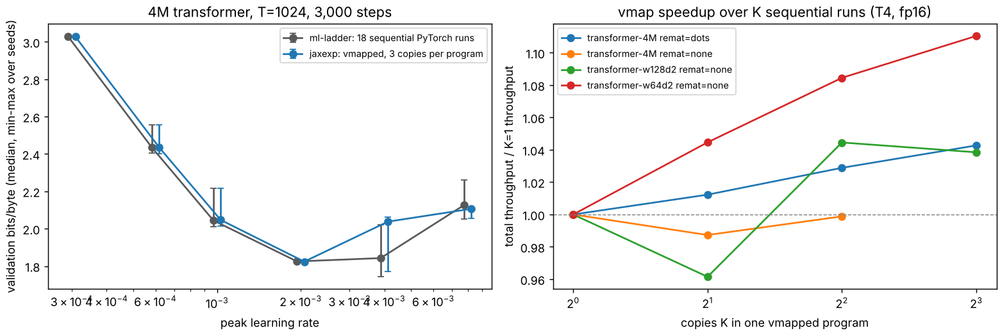
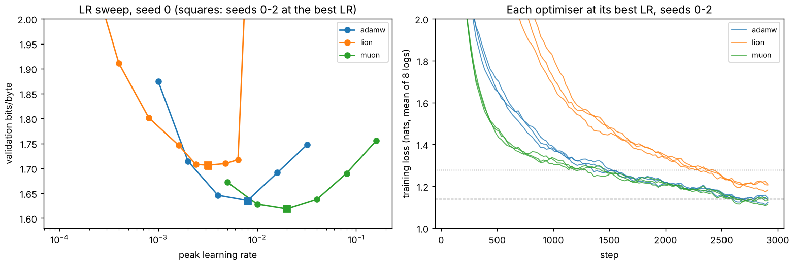

# M3 — Sweeps as one program, optimisers, gradient noise (N1, O3, N2)

> **Status:** N1 and O3 done; N2 in progress ·
> **Hardware:** Kaggle T4 ×2 (sm_75, one job per GPU), JAX 0.11.1; CPU (4 cores) for the equivalence tests ·
> **Data:** N1: [`data/n1-summary.json`](data/n1-summary.json) and [`data/n1/`](data/n1/) (one JSON and log per job); O3: [`data/o3-summary.json`](data/o3-summary.json) and [`data/o3/`](data/o3/); ml-ladder's references from its `docs/writeups/data/c-gpu-lr.json` and `c-gpu-lr2-1024.json` ·
> **Reproduce:** `uv run python tools/kaggle/push_r2.py <preset> --push` for `n1-calibrate`, `n1`, `n1-fork` and `n1-fork-torch`, then `uv run python experiments/n1_vmap_sweep/analyze.py`; O3: presets `o3-stage1` to `o3-stage4`, then `uv run python experiments/o3_optimizers/analyze.py`. CPU tests: `uv run pytest tests/test_n1_sweep.py tests/test_o3_optimizers.py`

## N1 — Hyperparameter sweeps as one program

### Question

ml-ladder's Part C §7 tuned the 4M transformer's learning rate with 18
separate runs. Can one vmapped program train all of them at once, and how much
faster is it?

### The idea

**A sweep is K copies of the same computation.** In JAX, training is a pure
function `step(params, opt_state, batch, lr)`. Stack K copies of every
argument on a leading axis, and `jit(vmap(step))` trains all of them in one
compiled program. The learning rate is just another vmapped argument.

So is everything else that differs between the runs:
- each copy's loss scale;
- its skipped steps;
- its batch stream: ml-ladder's runs of one seed share batches, so copies of
  one seed share one draw per step.

**Two questions, kept apart:**
- **Is it the same experiment?** Each copy of (lr, seed) starts from ml-ladder's
  initial weights for that seed and sees that seed's batches, so it can be
  paired with ml-ladder's run.
- **Is it faster?** Total throughput of K copies in one program, against one
  copy, which is the rate of K sequential runs.

### The math

`vmap` turns every operation on a $[\ldots]$-shaped array into one on a
$[K, \ldots]$-shaped array:
- a matmul $x W$ becomes a batched matmul $x_k W_k$;
- per-copy scalars (the loss, the gradient norm used for clipping, the
  loss-scale decision) become $[K]$-vectors.

Nothing couples the copies, so copy $k$ computes exactly what its sequential
run would, up to the order of floating-point reductions.

The speedup has a simple ceiling. If one copy already keeps the GPU's
arithmetic units busy, K copies take K times as long. vmap can only win back
idle time: kernel-launch overhead, small matmuls that underfill the device,
Python between steps.

### What we measure and why

- **Equivalence (CPU).** Two seeds × two learning rates, vmapped against four
  sequential runs. Checked in fp32 and fp16, for a GRU and a transformer.
- **The sweep (T4).** ml-ladder's §7 grid: peak learning rates {3e-4, 6e-4,
  1e-3, 2e-3, 4e-3, 8e-3} × seeds 0–2, for the 4M transformer at T=1024.
  Each run is 3,000 steps of 16 × 1024 bytes, then per-position bits/byte on
  262,144 validation bytes. It ran as six programs of three copies.
- **Memory.** XLA's compiled temp memory for K = 1 to 18 copies, with and
  without per-block remat.
- **Throughput.** Steady tokens/s for K = 1, 2, 4, 8 (and up to 32 for small
  models), over 200 steps each. Measured on ml-ladder's 4M model and on two
  much smaller transformers (width 128 and 64, depth 2) at the same 16 × 1024
  tokens per step.

### What I built

- **`jaxexp.sweep.train_many`:**
  - stacks K copies of parameters, optimiser state and loss scale;
  - runs `jit(vmap(make_step(...)))`;
  - follows each copy's own schedule;
  - draws each unique batch stream once per step.

  It returns one `TrainResult` per copy.
- **`tests/test_n1_sweep.py`:** vmapped copies equal sequential runs.
- **`experiments/n1_vmap_sweep/`:**
  - `run.py`, with `memory`, `throughput` and `sweep` studies;
  - `analyze.py`.
- **The Kaggle runner** now accepts jobs for any experiment script, and gives
  JAX 92% of the card instead of 75%.

### Results

**On CPU, vmap computes what the sequential runs compute.**

| | loss histories | all parameters (relative) | outputs on held-out data |
| --- | --- | --- | --- |
| fp32 | within $10^{-6}$ | within $10^{-6}$ | within $10^{-6}$ |
| fp16 | within $3\times10^{-3}$ | within $3\times10^{-3}$ | within $3\times10^{-3}$ |

Measured, the fp32 parameter differences are $9\times10^{-8}$ to $3\times10^{-7}$.

One tensor needed explaining: the attention key bias. Per tensor it differs by
up to 5% in fp16. Its true gradient is exactly zero, because adding a
constant vector to every key shifts all of a query's logits equally, and the
softmax ignores that. So its gradient is pure round-off, which Adam scales up
to full-size steps in either program. It has no effect on the outputs.

**On the T4, the sweep reproduces ml-ladder's curve.**

| peak LR | ml-ladder bits/byte | JAX, vmapped (3 per program) | largest per-seed difference |
| --- | --- | --- | --- |
| 3e-4 | 3.0279 (3.0259–3.0322) | 3.0272 (3.0261–3.0312) | 0.0010 |
| 6e-4 | 2.4353 (2.4041–2.5574) | 2.4358 (2.4002–2.5548) | 0.0040 |
| 1e-3 | 2.0441 (2.0123–2.2154) | 2.0470 (2.0140–2.2166) | 0.0029 |
| **2e-3** | **1.8250** (1.8229–1.8283) | **1.8239** (1.8203–1.8324) | 0.0095 |
| 4e-3 | 1.8427 (1.7427–2.0220) | 2.0378 (1.7692–2.0624) | 0.2197 |
| 8e-3 | 2.1271 (2.0509–2.2613) | 2.1067 (2.0571–2.1159) | 0.1454 |

- **The best learning rate is the same: 2e-3**, at 1.824 against 1.825.
- **Up to the optimum, all 12 pairs agree within 0.0095.** At these learning
  rates the seed-to-seed spread is often wider than that (6e-4: 0.15 in
  ml-ladder's own runs). So pairing by seed is doing real work: it takes the
  seed noise out of the comparison.
- **Above the optimum, pairs diverge** by up to 0.22 bits/byte. Yet our
  ranges overlap ml-ladder's, and its own seed spread there is 0.28 (4e-3)
  and 0.21 (8e-3). The largest gap, seed 2 at 4e-3, is a fork. Both runs are
  together through step 750 (2.153 against 2.137). Then ours stalls near
  1.67 from step 1,250 to 1,750, while ml-ladder's falls to 1.45.

  **A control traced this fork to PyTorch's own run, not to JAX or vmap.**

  | seed 2, lr 4e-3, 3,000 steps | bits/byte |
  | --- | --- |
  | ml-ladder's recorded PyTorch run (2026-10-08) | 1.8427 |
  | ml-ladder's script, rerun twice (same torch 2.11.0+cu128, T4) | 2.0121, 2.0413 |
  | JAX, sequential (R2's runner), twice | 2.0545, 2.0479 |
  | JAX, vmapped group of 3, twice | 2.0624, 2.0485 |

  - **All six fresh runs land together,** PyTorch and JAX, sequential and
    vmapped (2.01–2.06). The recorded 1.8427 is the outlier: PyTorch took the
    other branch once and did not reproduce it.
  - **Neither framework's T4 runs are deterministic,** so above the optimum
    one run per (lr, seed) samples a distribution. Its spread at 4e-3 is at
    least 0.22 bits/byte.

**vmap does not make this sweep faster.**

| copies K | 4M, total tok/s (no remat) | 4M, with remat | width-128 transformer | width-64 transformer |
| --- | --- | --- | --- | --- |
| 1 | 132.5k (1.00×) | 103.2k (1.00×) | 385k (1.00×) | 436k (1.00×) |
| 2 | 130.9k (0.99×) | 104.4k (1.01×) | 370k (0.96×) | 456k (1.04×) |
| 4 | 132.4k (1.00×) | 106.1k (1.03×) | 402k (1.04×) | 473k (1.08×) |
| 8 | out of memory | 107.6k (1.04×) | 400k (1.04×) | 484k (1.11×) |

- **A single copy already saturates the T4** at 16 × 1024 tokens per step. So
  K copies take K times as long, and total throughput is flat in K.
- **It stays nearly flat even for a 0.2M-parameter transformer** (1.11× at
  K=8). With T=1024 and 16 sequences per step, each step's attention and
  matmuls are large enough to fill the GPU whatever the model width.
- **Memory caps K before speed matters.** XLA's temp memory is 2.87 GiB per
  copy without remat, so K=4 fits (12.0 GiB) and K=6 does not (15.0 GiB,
  against 13.8 GiB available). Per-block remat cuts it to 1.26 GiB per copy,
  so K=8 fits, at 0.78× the speed.
- **The whole sweep cost 1.97 GPU-hours** (six programs of 1,137–1,233 s),
  against ml-ladder's 1.03 (18 runs × 205 s median). That 0.52× is the
  same JAX-against-PyTorch gap R2 measured for this model (0.53×), not a
  cost of vmap.

What vmap *does* buy is that the sweep is one program:
- each group compiles once (9–17 s), not once per run;
- all the copies share one data pipeline;
- the grid is one command and one JSON. N1's sweep tool is now ready for O3
  and N2.

### What surprised me

**PLAN's premise came from the wrong regime.** The image probe found that
K = 8 copies cost 4.4× one copy, which promised a 1.8× speedup. That probe
was a small recurrence whose single copy left the GPU idle. ml-ladder's
protocol feeds 16,384 tokens per step, which fills a T4 even with a 0.2M
model. The speedup from vmap is the GPU's idle fraction, and here there is
almost none.

**The attention key bias.** Its gradient is exactly zero by symmetry. That
showed up as a 5% per-tensor mismatch in what should have been an equality
test, and it is invisible in any loss.

**The biggest disagreement in the sweep was PyTorch disagreeing with itself.**
The one pair that looked like a framework difference (0.22 bits/byte) did
not survive reruns. ml-ladder's own script, on the same torch version and the
same GPU type, landed with JAX (2.01 and 2.04), not at its recorded 1.84.
At learning rates above the optimum, runs with identical weights and batches
split apart, and nondeterministic GPU arithmetic decides which side a run
lands on. The R3 copy task (M2) showed the same thing near its plateau.
A single run per configuration in this regime is a draw, not a measurement.

### Open threads

- **The small-batch regime.** vmap should pay when one copy cannot fill the
  device: small batches, short contexts, small models. That is the setting of
  many hyperparameter studies, and it was not measured here.
- **Deterministic GPU runs** (`--xla_gpu_deterministic_ops`;
  `torch.use_deterministic_algorithms`), to separate implementation from
  nondeterminism without repeats.
- **The fork's distribution.** How often does seed 2 at 4e-3 reach about 1.84
  rather than about 2.05? Ten repeats would put a number on ml-ladder's luck.
  The same applies to its 4e-3 entry in §7's table.
- **O3 and N2,** using this sweep tool.

## O3 — Optimisers beyond Adam

### Question

ml-ladder's B5 thread asks about Lion and Shampoo, and whether second-moment
scaling is the right primitive at all. On R2's 4M transformer, with every
optimiser at its own tuned learning rate, does anything beat AdamW?

### The idea

**Three answers to "how should a step be shaped?"**
- **AdamW** divides each coordinate's momentum by a running RMS of its
  gradient: second-moment scaling.
- **Lion** keeps only the *sign* of an interpolated momentum, so every
  coordinate moves by exactly the learning rate. It has no second moment at
  all.
- **Muon** orthogonalises the momentum of each weight matrix. It replaces
  $M = U\Sigma V^\top$ by roughly $UV^\top$, so every direction in the
  matrix's row and column spaces moves equally. That is Shampoo's
  preconditioner $(GG^\top)^{-1/4}\,G\,(G^\top G)^{-1/4}$ without its running
  accumulation: second-moment scaling of a whole matrix, rather than of each
  coordinate.

**Tune every arm** (ml-ladder §7, and CLAUDE.md). An untuned baseline
produces a fake winner. Each optimiser gets its own learning-rate sweep on
seed 0, extended until the best value is interior. Seeds 1–2 then run at
that value.

**N1's sweep tool makes this cheap to run:** each grid is one or two vmapped
programs.

### The math

With momentum $m_t$, gradient $g_t$ and peak LR $\eta$ (on ml-ladder's
schedule), and decoupled weight decay $\lambda$:

- **AdamW:** $\theta \mathrel{-}= \eta\,(\hat m_t/(\sqrt{\hat v_t}+\epsilon) + \lambda\theta)$,
  with $\beta = (0.9, 0.95)$ and $\lambda = 0.1$ (the protocol).
- **Lion:** $\theta \mathrel{-}= \eta\,(\operatorname{sign}(\beta_1 m_{t-1} + (1-\beta_1) g_t) + \lambda\theta)$,
  $m_t = \beta_2 m_{t-1} + (1-\beta_2) g_t$, with $\beta = (0.9, 0.99)$. Since
  $|\text{update}| = \eta$, Lion's good learning rates are 3–10× smaller than
  AdamW's. So $\lambda = 1.0$, ten times AdamW's, to keep $\eta\lambda$
  comparable, as the Lion paper recommends.
- **Muon** on each hidden matrix $W \in \mathbb{R}^{n_\text{in} \times n_\text{out}}$:
  $W \mathrel{-}= \eta\,(\sqrt{\max(1, n_\text{out}/n_\text{in})}\;\mathrm{NS}_5(\tilde m_t) + \lambda W)$.
  - $\tilde m_t$ is Nesterov momentum with $\beta = 0.95$.
  - $\mathrm{NS}_5$ is five steps of the quintic Newton–Schulz iteration that
    pushes the singular values towards 1.
  - $\lambda = 0.1$.

  Embeddings, the output head, biases and LayerNorm stay on the protocol's
  AdamW, at AdamW's tuned peak, on the same schedule.

### What we measure and why

- **Setting:** the 4M transformer (learned positions) at T=256, batch 64
  (16,384 tokens per step), 3,000 steps, fp16 with fused attention.
  Every run starts from ml-ladder's initial weights.
- **Anchor:** the AdamW arm at 2e-3, 4e-3 and 8e-3 must match ml-ladder's own
  runs at this setting (`c-gpu-lr2-256.json`).
- **Per optimiser:**
  - the LR curve on seed 0;
  - bits/byte at the best LR over seeds 0–2, as median (min–max);
  - steps to reach AdamW's training loss, at two levels: its level at step
    1,500, and its final level. The loss is smoothed as the mean of 8
    consecutive logs (200 steps), placed at the window's centre step. With a
    fixed-length cosine schedule, every
    run reaches the final level only near the end, so the halfway level is
    the informative one.

### What I built

- **`jaxexp.train.optimizer(kind=adamw|lion|muon)`.** The AdamW path is
  unchanged: R2's parity tests pass.
- **Muon is assembled from `optax.contrib.scale_by_muon` and the protocol's
  AdamW, via `optax.partition`.** optax's ready-made `muon(nesterov=True)`
  also applies Nesterov to its AdamW branch, which makes that branch NAdam,
  with first steps 1.47× larger. A test caught it.

  The AdamW part has its own peak. It follows the schedule through an
  injected `schedule` multiplier, so one vmapped program can sweep Muon's LR
  while the AdamW part holds still.
- **`tests/test_o3_optimizers.py`:**
  - Lion's first step is exactly ±η per element;
  - Muon orthogonalises exactly the eight block matrices (singular values in
    the Newton–Schulz band);
  - everything else gets AdamW's exact first step;
  - both optimisers give the same losses vmapped as sequentially.
- **`n1_vmap_sweep/run.py`** gains `--optimizer`, `--weight-decay` and
  `--adam-peak`; `experiments/o3_optimizers/analyze.py` scores the results.

### Results

**The AdamW arm lands on ml-ladder's runs** at this setting (seed 0): 1.7141
against 1.7155 at 2e-3, 1.6462 against 1.6436 at 4e-3, and 1.6357 against
1.6239 at 8e-3. ml-ladder's grid stopped at 8e-3, its best value. Extending
it shows that 8e-3 really is the optimum: 1.6e-2 gives 1.6912, and 3.2e-2
gives 1.7475.

| optimiser (tuned) | peak LR | weight decay | bits/byte, seeds 0–2 | steps to AdamW's halfway loss | tokens/s (T4) |
| --- | --- | --- | --- | --- | --- |
| AdamW (protocol) | 8e-3 | 0.1 | 1.6335 (1.6333–1.6357) | 1,362–1,537 | 240k |
| **Muon** (+ AdamW at 8e-3) | 2e-2 | 0.1 | **1.6190** (1.6186–1.6212) | **1,212–1,462** | 172k (0.72×) |
| Lion | 3.2e-3 | 1.0 | 1.7056 (1.6976–1.7063) | 2,312–2,387 | 234k |

- **Muon is best, by 0.0145 bits/byte.** Its three seeds (1.6186–1.6212) and
  AdamW's (1.6333–1.6357) do not overlap. It reaches AdamW's halfway training
  loss about 1.13× sooner in steps (median 1,312 against 1,487).
- **But Muon costs more per step.** Five Newton–Schulz iterations on every
  matrix make it run at 0.72× AdamW's throughput on the T4. Measured in time,
  it reaches the halfway loss about 23% *later*: 1,312 steps at 1.40× the cost
  per step is worth about 1,830 AdamW steps. Whether AdamW given 40% more
  steps would close the 0.0145 gap was not measured.
- **Lion is clearly worse here, after tuning both of its knobs.**
  - Its LR curve is flat around its optimum: 1.7079, 1.7063 and 1.7096 at
    2.4e-3, 3.2e-3 and 4.8e-3. It diverges from 1.28e-2.
  - Weight decay matters, and 1.0 is an interior optimum. At 3.2e-3, wd 0.1
    gives 3.68 (unstable), 0.3 gives 2.07, and 1.0 gives 1.71; at 1.6e-3,
    wd 3.0 gives 1.79.
  - The gap to AdamW is 0.072 bits/byte, and Lion needs about 1.6× as many
    steps to reach AdamW's halfway loss.
- **fp16 was healthy at every tuned setting:** no skipped steps. Steps were
  skipped only in runs that diverged or nearly did (Lion at 1.28e-2 and above,
  or with wd 0.1).
- **Cost.** O3 took four kernels: 36 runs of 3,000 steps, as 14 vmapped
  programs of 2–3 copies, totalling 2.33 GPU-hours of program time on T4s.

### What surprised me

**Lion needs its weight decay.** Lion's step has a fixed size, so without
enough decay the weights grow until the sign updates are relatively too small
to steer them. Lowering λ from 1.0 to 0.3 cost 0.37 bits/byte at 3.2e-3, and
0.1 made the run unstable. The Lion paper's rule of thumb (λ 3–10× AdamW's) is
not a nicety; here it is most of the tuning.

**Lion loses at this batch size.** Lion's own paper reports its gains at
large batches. Here a step is 64 sequences of 256 bytes, and the sign of a
noisy momentum throws away the magnitude information that AdamW keeps. That
is a hypothesis, not a measurement; the batch-size axis is N2's.

**optax's Muon is not plain Muon.** `optax.contrib.muon(nesterov=True)` also
turns the AdamW it applies to non-matrix parameters into NAdam: a 1.47×
larger first step, and a different optimiser for embeddings and the head. It
only showed up because the test computed AdamW's first step by hand. The
first version of that test failed on gradient clipping and on Adam's ε before
it was exact.

**A step-count win can be a wall-clock loss.** Muon's 1.13× fewer steps
become a 23% slower time on a T4, where five Newton–Schulz iterations per
matrix are not hidden behind anything.

### Open threads

- **Equal-time comparison.** Give AdamW 1.4× the steps, so it has Muon's
  wall-clock time, and see whether Muon's 0.0145 survives.
- **Muon's details:**
  - orthogonalise q, k and v separately rather than the fused 256×768 matrix;
  - tune its AdamW part's LR jointly;
  - try fewer Newton–Schulz steps, or bf16 iterations on hardware with fast
    bf16.
- **Lion at larger batches.** Use N2's critical batch size to choose where to
  look.
- **Longer runs and the 25M model.** 3,000 steps of a 4M model is a short
  horizon; the ranking may not hold at R2's 12,000 steps.
- **A Shampoo-family optimiser proper** (`distributed_shampoo`, SOAP or
  PSGD-Kron), once one runs with optax 0.2.8. `psgd-jax` 0.2.9 imports
  optax internals that no longer exist.

## N2 — Gradient noise scale and the critical batch size

### Question

ml-ladder's B5 thread names the learning-rate/batch-size scaling rule as a
scaling-law question. The gradient noise scale (McCandlish et al., 2018)
claims to predict, from gradients alone, the critical batch size: the batch
beyond which doubling the batch no longer halves the steps. Measured on R2's
4M transformer, does it?

### The idea

**A step averages B noisy per-example gradients.** When the noise in that
average dominates, a bigger batch buys a proportionally better step, and
doubling B halves the steps. When the signal dominates, extra examples are
wasted. The crossover is where the noise in a batch-B gradient, tr Σ / B, is
about as large as the signal |G|². That is, B ≈ tr Σ / |G|², the *simple
noise scale*.

**JAX makes the measurement one line.** `vmap(grad)` over the batch axis gives
every example's gradient at once.

**Test the prediction directly.** Train at three batch sizes, each with its
own tuned learning rate, and count the steps to fixed losses. Fit the
paper's step–batch relation, and compare its B_crit with B_simple measured
at the same loss.

### The math

With per-example gradients $g_i$, their mean $G$ and covariance $\Sigma$:
$\mathbb{E}\,\overline{|g_i|^2} = |G|^2 + \operatorname{tr}\Sigma$ and
$\mathbb{E}\,|G_B|^2 = |G|^2 + \operatorname{tr}\Sigma/B$.

So one batch gives unbiased
$\widehat{\operatorname{tr}\Sigma} = (\overline{|g_i|^2} - |G_B|^2)\,B/(B-1)$ and
$\widehat{|G|^2} = (B|G_B|^2 - \overline{|g_i|^2})/(B-1)$. Then
$B_\text{simple} = \overline{\widehat{\operatorname{tr}\Sigma}} / \overline{\widehat{|G|^2}}$,
a ratio of averages over batches. A ratio of single-batch estimates would be
biased.

McCandlish et al. find that the steps $S$ and examples $E$ to reach a fixed
loss trade off as $(S/S_\text{min} - 1)(E/E_\text{min} - 1) = 1$. With
$E = BS$, that means $S(B) = S_\text{min}(1 + B_\text{crit}/B)$, where
$B_\text{crit} = E_\text{min}/S_\text{min}$. They report
$B_\text{crit} \approx B_\text{simple}$ when the Hessian is close to a
multiple of the identity, and $B_\text{simple}$ underestimating it
otherwise.

### What we measure and why

- **Model and protocol:** R2's 4M transformer at T=256, AdamW as the
  protocol, from ml-ladder's initial weights. B counts sequences of 256
  bytes, and an "example" is one sequence.
- **Noise run.** B=64 (the protocol's 16,384 tokens per step) at O3's tuned
  LR of 8e-3, 6,000 steps. Every 250 steps, B_simple is computed in fp32 on 8
  fresh batches of 64 from a sampler separate from training.
- **Batch runs.** B = 16, 64 and 256, with 12,000, 6,000 and 3,000 steps
  respectively. Each has a three-point LR grid centred on √-scaling from
  8e-3 at B=64: {2, 4, 8}e-3, {4, 8, 16}e-3 and {8, 16, 32}e-3.
- **The schedule is warmup-then-constant, not the protocol's cosine.** With a
  cosine decay, the step at which a loss is first reached depends on the
  run's total length.
- **Steps to a target:** the first step at which the training loss, smoothed
  over 8 logs (200 steps), reaches L, at the best LR for that batch size.
  Targets L from 1.6 down to 1.2 nats.

### What I built

- **`jaxexp.noise`:**
  - `make_per_example`: `vmap(grad)` in chunks, returning each example's
    |gᵢ|² and the gradient sum;
  - `batch_estimates`: the unbiased pair above;
  - `noise_scale`: the ratio of averages.
- **`tests/test_n2_noise.py`:**
  - vmapped per-example gradients equal an explicit loop;
  - their mean equals the batch gradient;
  - the estimates are unbiased on a synthetic population (within 2% and 5%);
  - a known B_simple of 10 is recovered within 5%.
- **`jaxexp.train`:** a `warmup-constant` schedule, and an
  `on_log(step, params)` hook whose time is excluded from the training time.
- **`experiments/n2_noise_scale/`:** `run.py` (`noise` and `batch` studies)
  and `analyze.py`.

### Results

N2_RESULTS

### What surprised me

N2_SURPRISES

### Open threads

N2_THREADS
