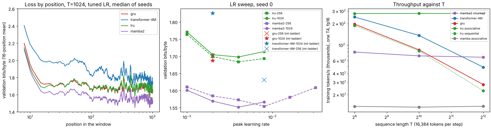

# M4 — Parallel scans and compiled decoding (N4, O4)

> **Status:** N4 done; O4 next ·
> **Hardware:** N4: Colab T4 (calibration, LRU sweeps) and Kaggle T4 ×2 (Mamba-2 sweeps, copy task), JAX 0.11.1; CPU (4 cores) for the equivalence tests ·
> **Data:** N4: [`data/n4-summary.json`](data/n4-summary.json) and [`data/n4/`](data/n4/) (one JSON and log per job); ml-ladder's references from its `docs/writeups/data/c-gpu.json`, `c-gpu-lr.json`, `c-gpu-lr2-256.json` and `c-gpu-lr3-gru-*.json` ·
> **Reproduce:** `uv run python tools/kaggle/push_r2.py <preset> --push` for `n4-calibrate`, `n4-lru`, `n4-mamba2` and `n4-copy`, then `uv run python experiments/n4_scans/analyze.py`. CPU tests: `uv run pytest tests/test_n4_ssm.py`

## N4 — Parallel scans: linear recurrences against the GRU and the transformer

### Question

In ml-ladder's Part C the GRU was the best 4M model at T=256 and T=1024, but
it walks the sequence one step at a time: cuDNN's GRU ran at 86k tokens/s at
T=1024 against the 4M transformer's 136k (both measured here, in JAX, on one T4).
Its state is fixed (two layers of 592 numbers), and fixed-state recurrences
cannot copy a long sequence: R3's LSTM (two layers of 512) fails the copy task
from n=128.

A *linear* recurrence keeps the fixed-size state but drops the nonlinearity
between steps, and that lets it train in parallel. Three questions:

- **Speed and memory.** Does a parallel scan give transformer-like (or better)
  training speed with the RNN's flat memory profile?
- **Quality.** At about 4M parameters and ml-ladder's protocol, where does it
  land between the GRU and the transformer in bits/byte, and does its loss
  keep falling with position like the transformer's, or flatten like the
  GRU's?
- **Copying.** Does it fail the copy task, as a fixed-state model should?

### The idea

**A linear recurrence is a prefix product.** The GRU's update
$h_t = f(h_{t-1}, x_t)$ is nonlinear in $h_{t-1}$, so step $t$ needs step
$t-1$ first. A diagonal linear recurrence

$$h_t = a_t \odot h_{t-1} + b_t,$$

with $a_t$ and $b_t$ computed from the input alone, is different. Write each
step as the pair $(a_t, b_t)$, a map $h \mapsto a_t h + b_t$. Composing two
such maps gives another one:

$$(a_1, b_1) \bullet (a_2, b_2) = (a_1 a_2,\; a_2 b_1 + b_2).$$

This operator is associative, so all $T$ prefixes can be computed by a
parallel scan in $O(\log T)$ depth and $O(T)$ work (`lax.associative_scan`).
The nonlinearity moves out of the recurrence, into the layers between
recurrences.

**Three models**, each about 4M parameters, sharing the byte-level shell of
ml-ladder's language models (embedding, residual blocks, LayerNorm, linear head):

- **LRU** (Orvieto et al. 2023). A complex diagonal recurrence with a fixed
  transition $\lambda = \exp(-e^{\nu} + i e^{\theta})$, $|\lambda|$ initialised
  in $[0.9, 0.999]$. The input is normalised by $\sqrt{1 - |\lambda|^2}$.
  Each block is an LRU mixer and a GELU MLP. The transition does not depend
  on the input, so the LRU decides *how long* to remember per channel, but
  not *what*.
- **Mamba-1 (S6)** (Gu & Dao 2023). The transition depends on the input:
  $a_t = \exp(\Delta_t A)$ and $b_t = \Delta_t B_t x_t$, with $\Delta_t$,
  $B_t$, $C_t$ computed from $x_t$ ("selection"). The state is
  [channels × 16] per position. A causal depthwise convolution precedes it
  and a SiLU gate follows.
- **Mamba-2 (SSD)** (Dao & Gu 2024). The same selection, but with a *scalar*
  decay per head. That turns the scan into matrix products in chunks of 64
  positions: an attention-like masked product inside each chunk, and a
  short recurrence across chunks.

**Why Mamba-2 is here.** Mamba-1 without its fused CUDA kernel materialises a
[batch, T, 512, 16] state for the scan. The parallel scan then stores
$O(\log T)$ copies of it for the backward pass. It ran, but at 13.7k tokens/s
and 2 GiB with remat, and 12.4 GiB of temp memory without. That is a
statement about the missing kernel, not about selective SSMs. Mamba-2's chunked
form uses the matmul units that a T4 has instead, so it is the fair
selective-SSM arm for the quality and copy comparisons.

### The math

**Cost per training step**, for $T$ positions and state width $N$ per channel:

| | work | sequential depth | activations stored |
| --- | --- | --- | --- |
| GRU (`lax.scan` / cuDNN) | $O(T)$ | $T$ | $O(T)$ |
| linear scan, sequential | $O(T)$ | $T$ | $O(T)$ |
| linear scan, associative | $O(T)$ | $O(\log T)$ | $O(T)$ (a few times more) |
| SSD, chunk $Q$ | $O(TQ + T N)$ | $T / Q$ (across chunks) | $O(T Q)$ per head |
| attention | $O(T^2)$ | $1$ | $O(T^2)$ without a fused kernel |

At a fixed 16,384 tokens per step (ml-ladder's protocol), the batch shrinks
as $T$ grows. A recurrence's cost per token is then independent of $T$; a
sequential one's depth grows with $T$; attention's cost per token grows
linearly in $T$.

**Why a fixed state cannot copy.** In the copy task, the model reads $n$
random symbols from a 32-symbol vocabulary and must reproduce them. At the
separator it must carry $n \log_2 32 = 5n$ bits in its state. The LRU's state
is 256 complex numbers per layer, but each is a leaky average of the past, and
storing a sequence in it needs distinct, slowly decaying channels per
position. Nothing stops a linear model from learning a delay line for small
$n$; the question is where the state runs out.

### What we measure and why

- **Equivalence (CPU).** The associative scan equals a Python loop, for real
  and complex inputs; scan modes agree in value and gradient; chunked SSD
  equals the step-by-step recurrence (with padding, one chunk, and ragged
  lengths); all models are causal.
- **Speed and memory (T4).** Training tokens/s and XLA's compiled temp memory at
  T = 256, 1024 and 4096, fp16 matmuls, 16,384 tokens per step. Arms: the 4M
  transformer (fused attention), the GRU (`lax.scan`), LRU (associative and
  sequential), Mamba-1 (associative and sequential, remat) and Mamba-2
  (chunked and sequential).
- **Quality (T4).** enwik8 bits/byte on ml-ladder's protocol (3,000 steps of
  16,384 bytes, AdamW β=(0.9, 0.95), clipping at 1.0, 5% warmup then cosine
  to 10%; 262,144 validation bytes), at T=256 and T=1024. Weight decay is 0.1
  for the new arms and the transformer, and 0 for the GRU (ml-ladder's
  settings).
  Each new arm gets its own LR sweep on seed 0 over {1e-3, 2e-3, 4e-3, 8e-3},
  then seeds 0–2 at its best LR. The baselines are ml-ladder's own runs at
  their tuned LRs: GRU 2e-3 at both lengths; transformer 2e-3 at T=1024 and
  8e-3 at T=256.
- **Loss by position.** Bits at each position in the window, median over
  seeds. Its summary is the *context gain*: the mean bits at positions
  $[T/8, T/4)$ minus those in the last quarter. It is what the second half of
  the window buys.
- **Copying.** R3's task: n = 32, 128, 512, 1,500 steps, second-half accuracy
  on 512 held-out sequences, seeds 0–2, each model at 2e-3 as in R3.

### What I built

- **`jaxexp.ssm`** — the three models as pure functions over dicts of arrays.
  - `linear_scan(a, b, mode)` runs the recurrence as `associative`
    (`lax.associative_scan`) or `sequential` (`lax.scan`).
  - `ssd(x, dta, b, c, chunk)` is Mamba-2's chunked form; `ssd_sequential` is
    the reference recurrence. `_segsum` builds the in-chunk decay matrix as a
    masked cumulative sum (a difference of two cumulative sums loses
    precision), with $-\infty$ above the diagonal so `exp` gives exact zeros.
    A test checks that no NaN from those entries reaches the gradients.
  - `apply(params, ids, kind, scan=..., compute_dtype=..., remat=...)`.
    `compute_dtype` applies to the dense projections only; recurrences,
    gates, LayerNorms and the residual stream stay in fp32.
- **Runners.** `experiments/r2_enwik8/run.py` and
  `experiments/n1_vmap_sweep/run.py` take `--model lru|mamba|mamba2` and
  `--scan`, so the LR sweeps run as vmapped groups (N1) on ml-ladder's
  batches for each seed, and the copy task runs on R3's code unchanged.
  `experiments/n4_scans/run.py` measures throughput and memory against $T$;
  `analyze.py` builds the tables and figure.
- **Tests.** `tests/test_n4_ssm.py`, 13 tests (above).

### Results

*Left: validation bits/byte at each position of the 1,024-byte window, each
model at its tuned LR, median of seeds 0–2 (16-position running mean). The
GRU's and the transformer's curves are ml-ladder's own runs. Middle: seed 0's
LR sweeps (lines) and ml-ladder's tuned baselines (markers). Right: training
throughput on one T4 at a fixed 16,384 tokens per step.*

**Speed and memory (Colab T4, fp16 matmuls, 16,384 tokens per step).**
Training tokens/s, in thousands, and XLA's compiled temp memory for one step:

| arm | T=256 | T=1024 | T=4096 | temp memory (GiB) |
| --- | --- | --- | --- | --- |
| transformer-4M (fused attention) | 248 | 136 | 49 | 1.38 / 2.87 / 9.26 |
| GRU (`lax.scan`) | 196 | 86 | 28 | 1.01 |
| LRU, associative scan | **276** | **278** | **277** | 1.19 |
| LRU, sequential scan | 187 | 83 | 23 | 1.71 |
| Mamba-2, chunked (SSD) | 80 | 70 | 67 | 3.39 / 3.34 / 3.33 |
| Mamba-1, associative (remat) | 13.7 | 13.4 | 13.8 | 2.08 / 1.96 / 2.02 |
| Mamba-2 or Mamba-1, sequential | out of memory | | | 38.1 / 23.6 |

- **The parallel scan removes the dependence on T.** The associative LRU runs
  at 277k tokens/s at every length; the same recurrence run sequentially
  falls from 187k to 23k, the GRU's curve. At T=4096 it is 12× its sequential
  self, 10× the GRU and 5.7× the transformer.
- **Memory stays flat too:** 1.19 GiB at every T, against the transformer's
  2.87 → 9.26 GiB as its T×T scores grow.
- **Mamba-2's chunked form is flat but slower:** 67–80k tokens/s, a quarter
  of the LRU, and a third (T=256) to a half (T=1024) of the transformer; it
  passes the transformer only at T=4096. Its step is a chain of einsums over
  chunk-by-chunk decay matrices and per-head states, 3.3 GiB of temp memory.
- **The sequential selective scans do not fit:** a `lax.scan` over Mamba-2's
  [heads, 64, 64] state stores it at every step for the backward pass, 38 GiB.
- **vmapped copies at T=1024** (temp GiB for K = 1, 2, 3 without remat):
  LRU 1.18 / 2.40 / 3.59, Mamba-2 3.69 / 6.63 / 9.95, Mamba-1 12.4 / 15.2 /
  37.9. So the LRU sweeps ran as one program of 4 copies and Mamba-2's as
  groups of 2.

**enwik8 (3,000 steps, ml-ladder's protocol).** Seed 0's LR curves (bits/byte):

| | 1e-3 | 2e-3 | 4e-3 | 8e-3 | 1.6e-2 | 3.2e-2 |
| --- | --- | --- | --- | --- | --- | --- |
| LRU, T=1024 | 1.771 | 1.705 | **1.698** | 1.714 | | |
| LRU, T=256 | 1.764 | 1.699 | **1.684** | 1.693 | | |
| Mamba-2, T=1024 | 1.601 | 1.569 | **1.552** | 1.566 | | |
| Mamba-2, T=256 | 1.611 | 1.584 | 1.573 | **1.554** | 1.580 | 1.608 |

Every best LR is interior. Seeds 0–2 at the best LR, median (min–max), with
ml-ladder's tuned baselines:

| | T=256 | T=1024 |
| --- | --- | --- |
| transformer-4M (ml-ladder; 8e-3 / 2e-3) | 1.631 (1.624–1.634) | 1.825 (1.823–1.828) |
| GRU (ml-ladder; 2e-3) | 1.701 (1.700–1.701) | 1.687 (1.687–1.692) |
| LRU (4e-3) | 1.686 (1.684–1.688) | 1.698 (1.693–1.699) |
| Mamba-2 (8e-3 / 4e-3) | **1.578 (1.554–1.581)** | **1.567 (1.552–1.571)** |

- **The LRU is a GRU that trains in parallel.** It lands within 0.015
  bits/byte of the GRU at both lengths (0.015 better at T=256, 0.011 worse at
  T=1024), at 3.2× the GRU's speed at T=1024.
- **Mamba-2 is the best 4M model here, by a wide margin:** 0.12 bits/byte
  better than the GRU at T=1024 and 0.05 better than the tuned transformer at
  T=256. At T=1024 it beats the transformer by 0.26.
- **Seed 0 is the best Mamba-2 run at both lengths, by about 0.02.** It is
  also the seed the LRs were picked on, so it was run again, alone, at both
  best LRs: 1.5595 at T=1024 (first run 1.5515) and 1.5513 at T=256
  (1.5537). It reproduces within 0.008 and stays ahead of seeds 1–2
  (1.567–1.581), so seed 0 is a better draw of initial weights and batches,
  not a lucky run. The medians above use the first runs.

**Loss by position.** The gap to the GRU at the same positions (bits/byte,
median curves; both models are scored on the same validation windows, so the
text's own difficulty at each position cancels):

| T=1024 | 0–8 | 8–64 | 64–256 | 256–1024 | trend |
| --- | --- | --- | --- | --- | --- |
| transformer-4M | +0.160 | +0.255 | +0.179 | +0.118 | −0.075 |
| LRU | −0.036 | −0.006 | +0.006 | +0.010 | −0.000 |
| Mamba-2 | −0.056 | −0.099 | −0.120 | −0.128 | −0.004 |

*Trend: the gap in the last quarter minus the gap at positions [T/8, T/4);
negative means gaining on the GRU as the context grows.*

- **The LRU behaves like the GRU at every position.** Its gap stays within
  0.04 everywhere and does not trend: past the first ~64 bytes, neither uses
  more context.
- **Mamba-2 is ahead from the first bytes and pulls away up to a few hundred
  bytes,** then holds a constant lead: its gap grows from −0.06 to −0.12 by
  position 256 and only to −0.13 after. So it uses more context than the GRU,
  but not the whole window.
- **Only the transformer keeps gaining** (trend −0.075 at T=1024, −0.065 at
  T=256). At T=1024 it starts so far behind that it is still 0.12 worse
  than the GRU in the last three quarters; at T=256 it is level with the GRU
  over the first 8 bytes and 0.09 ahead by positions 64–256.
- **Raw per-position curves are noisy.** Bin to bin, the GRU's and the LRU's
  curves move together by ±0.03 with the text, so a model's own "context
  gain" (early bits minus late bits) is noise at the ±0.02 level; only the
  paired gap is informative.

**Copying (R3's task, 1,500 steps, second-half accuracy; chance 0.031).**

| n | LSTM (R3) | GRU | LRU | Mamba-2 (2e-3) | transformer-4M (R3) |
| --- | --- | --- | --- | --- | --- |
| 32 | 0.893 (0.864–0.910) | 0.886 (0.851–0.917) | **1.000** (all) | 0.065 (0.056–0.996) | 1.000 |
| 128 | 0.031 | 0.202 (0.201–0.208) | **1.000** (all) | 0.031 | 1.000 |
| 512 | 0.031 | 0.040 (0.034–0.040) | 0.148 (0.132–0.159) | 0.031 | 1.000 (0.981–1.000) |

- **The LRU copies 128 symbols perfectly**, where both gated RNNs fail; at
  n=512 it gets 15%, five times chance. Its state is 256 complex numbers per
  layer; 128 symbols are $5 \times 128 = 640$ bits, 512 symbols 2,560.
- **Mamba-2 fails even at n=32 on two seeds of three.** This is optimisation,
  not capacity. A sweep on seed 0 at n=32 (bits are second-half accuracy):
  5e-4: 0.137; 1e-3: 0.130; 2e-3: 0.065; 4e-3: 0.029; 8e-3: 0.030;
  COPYLR. Its loss falls slowly through all 1,500 steps, and COPYLONG
- **The transformer remains the only model that copies 512.**

### What surprised me

- **The LRU learns to copy almost at once.** At n=32 its training loss is at
  the task's floor by step 375, the first one logged: 1.71 nats, which is
  $\ln 32 = 3.47$ on the unpredictable first half and about 0 on the copy. The
  GRU is still at 1.88 after 1,500 steps, and Mamba-2 at 3.39. The LRU is
  causal (`tests/test_n4_ssm.py` changes one input and checks every earlier
  output is unchanged) and both scan modes agree, so this is not a leak. A fixed, input-independent linear recurrence can hold a delay line:
  a channel with $|\lambda| \approx 1$ and a phase that rotates by a fixed angle
  per step keeps each past symbol at a recoverable angle. Copying is the task
  such a memory is built for, and the GRU's gates have to learn it.
- **The best language model here is the slowest to learn to copy.** Mamba-2
  leads on enwik8 and trails on the copy task, the opposite ranking to the
  LRU's. A plausible reading, not tested: its decays are chosen from the
  input, which text rewards, while holding 32 random symbols needs decays
  held near 1 for exactly the copy's duration, a setting the LRU starts with
  and Mamba-2 must find.
- **Mamba-1 without its kernel is a memory problem, not a speed one.** Its
  associative scan materialises the [B, T, 512, 16] state at every level of
  the scan tree. Remat brings 12.4 GiB to 2 GiB, but the step is then 20×
  slower than the LRU's. Mamba-2 exists for this reason: the scalar decay per
  head turns the scan into matmuls.
- **Run-to-run noise on the GPU is 0.014 bits/byte for Mamba-2.** The same
  T=256 run at 1.6e-2 gave 1.567 on Colab and 1.580 on Kaggle. Gaps between
  seeds of 0.02 are at the edge of what one run can show.

### Open threads

- **Equal compute, not equal steps.** Mamba-2 runs at a third to a half of
  the transformer's tokens/s at T ≤ 1024, so at equal GPU-hours the
  transformer would get two to three times the steps. Its lead at equal steps
  may not survive that comparison; it was not run.
- **Why the LRU stops at a few hundred bytes of context.** Its |λ| is
  initialised in [0.9, 0.999], so its longest memory starts at about 1,000
  steps; whether training moves it, and whether r_max = 0.9999 helps T=1024,
  was not tried.
- **Copying with more steps or a curriculum for Mamba-2,** and the copy task
  for the transformer at the LRU's speed.
- **A fused kernel for Mamba-1's selective scan** (Pallas, on a TPU; Kaggle's
  GPUs cannot run Pallas, see CLAUDE.md). The question it answers: is the 20×
  gap to the LRU the missing kernel, or the [channels × state] state?
