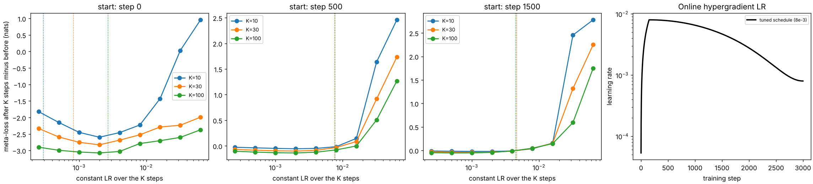
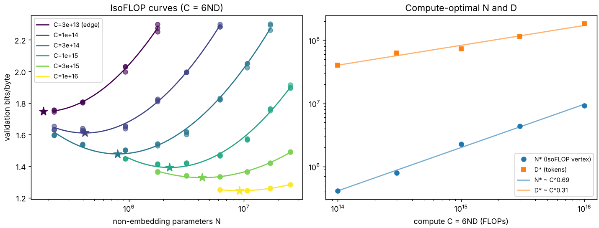

# M7 — Hypergradients, diffusion samplers, a scaling law (N3, N8, O6)

> **Status:** N3, N8 and O6 done ·
> **Hardware:** Kaggle T4 ×2 (one job per GPU), JAX 0.11.1; N3's constant-LR controls on a Colab T4 (same JAX, Flax and Optax versions); CPU (4 cores) for the tests, N8's seed-2 diagnosis and O6's token caches ·
> **Data:** N3: [`data/n3-summary.json`](data/n3-summary.json) and [`data/n3/`](data/n3/) (one JSON and log per job; the first run, whose landscape batches were not yet keyed, in `data/n3/first-run/`); N8: [`data/n8-summary.json`](data/n8-summary.json) and [`data/n8/`](data/n8/) (one JSON and log per seed, sample grids as `.npy`, the CPU diagnosis of seed 2, and the first run, without the PyTorch control, in `data/n8/first-run/`); O6: [`data/o6-summary.json`](data/o6-summary.json) and [`data/o6/`](data/o6/) (the LR sweeps, the 18 IsoFLOP jobs, `lr-table.json`, and the kernels' logs) ·
> **Reproduce:** N3: `uv run python tools/kaggle/push_r2.py <preset> --push` for `n3b`, `n3c` and `n3d`; the controls are `experiments/n3_hypergrad/run.py --studies reference --constant-lr <1e-3|2e-3> --seed <0|1|2>`; then `uv run python experiments/n3_hypergrad/analyze.py`. N8: preset `n8b` (its seed 0 lane failed on the MNIST race and was rerun as a lane of O6's `o6e`), then `uv run python experiments/n8_diffusion/analyze.py`; the seed-2 diagnosis is `PYTHONPATH=src python experiments/n8_diffusion/diag_seed2.py <out.json>` (CPU, ~1 h). O6: `run.py --studies tokenize` on CPU builds the token caches (uploaded as the private Kaggle dataset `jaxexp-bpe`); presets `o6a` and `o6e` (LR), `o6c` and `o6d` (IsoFLOP); then `uv run python experiments/o6_scaling/analyze.py` (~20 min, mostly the bootstrap). CPU tests: `uv run pytest tests/test_n3_hypergrad.py tests/test_n8_diffusion.py tests/test_o6_bpe.py`

## N3 — Learning the learning rate: hypergradients through training

### Question

N1 found the 4M transformer's best learning rate by search: 18 runs, one per
(LR, seed). Training is a differentiable function of its learning rate, so
`jax.grad` can, in principle, find that rate by gradient instead. Two
questions:

- **Does the hypergradient point at the tuned LR?** Starting from a point in
  training and looking K steps ahead, which LR does the gradient prefer, and
  how does it compare with the LR the tuned schedule uses at that point?
- **Can it set the LR online?** Train 3,000 steps with the LR updated by its
  own hypergradient every K steps, and compare the final bits/byte with the
  tuned schedule.

The literature predicts a specific failure: **short-horizon bias**.
Hypergradients over short horizons favour small, greedy learning rates,
because a small step reduces the loss soonest even when a larger one would
reach a lower loss later (Wu et al. 2018).

### The idea

**Training is a function, so it has a derivative.** K steps of AdamW map
$(\theta_0, \eta_1, \dots, \eta_K)$ to $\theta_K$. The validation loss after
them, $L_{\text{val}}(\theta_K)$, is a scalar function of the learning rates,
and reverse mode differentiates it through every step: through the forward
and backward passes of each step (a second derivative of the model), through
Adam's moments and bias correction, through the clipping and the weight decay.

**The meta-loss.** Its gradient with respect to $\log \eta$ (log, so that a
step changes the LR by a factor) is the hypergradient. Its zero crossing is
the LR that minimises the loss K steps later: the *K-step-greedy* LR.

**What it costs.** Reverse mode through K steps stores what each step's
backward pass needs. With `jax.checkpoint` around every step, it stores only
the carry ($\theta$, $m$, $v$: three copies of the parameters) per step and
recomputes the rest, so memory grows with K times 50 MB for the 4M model
rather than K times the activations.

### The math

One AdamW step, as ml-ladder's protocol runs it (clipping at global norm 1,
$\beta = (0.9, 0.95)$, $\epsilon = 10^{-8}$, decoupled weight decay
$\lambda = 0.1$):

$$g \leftarrow g \min\!\left(1, \tfrac{1}{\lVert g \rVert}\right), \quad
m \leftarrow \beta_1 m + (1-\beta_1) g, \quad
v \leftarrow \beta_2 v + (1-\beta_2) g^2,$$

$$\theta \leftarrow \theta - \eta \left(\frac{m / (1-\beta_1^t)}{\sqrt{v / (1-\beta_2^t)} + \epsilon} + \lambda \theta\right).$$

The hypergradient for the segment's shared LR is

$$\frac{\partial L_{\text{val}}(\theta_K)}{\partial \log \eta}
= \sum_{k=1}^{K} \eta_k \frac{\partial L_{\text{val}}(\theta_K)}{\partial \eta_k},$$

the sum of the per-step hypergradients; the code computes both. Each
$\partial \theta_K / \partial \eta_k$ propagates through the later steps'
Jacobians $\partial \theta_{j+1} / \partial \theta_j$, which contain the
Hessian of the training loss. That is where the second derivative enters.

**Why a short horizon prefers a small LR.** On a quadratic valley with
curvature $h$, gradient descent at rate $\eta$ shrinks the error along it by
$(1 - \eta h)$ per step. Over a short horizon the loss is dominated by the
highest-curvature directions, which a large $\eta$ overshoots (or destabilises),
while the low-curvature directions, where a large $\eta$ pays, contribute only
over many steps. The greedy optimum therefore sits below the long-run optimum,
and the shorter the horizon, the further below.

### What we measure and why

- **Equivalence (CPU).** The differentiable AdamW equals the training
  optimiser (`jaxexp.train.optimizer("adamw")`) step for step. The
  hypergradient equals a central finite difference (float64), and remat
  changes nothing.
- **The reference.** The tuned protocol in this setting: 3,000 steps of
  64 × 256 bytes, peak 8e-3 (the best LR at T=256 in ml-ladder's
  `c-gpu-lr2-256.json` and in O3), 5% warmup, cosine to 10%, fp32. It saves
  checkpoints at steps 500 and 1,500.
- **The landscape.** From step 0 and the two checkpoints, for K = 10, 30 and
  100: the meta-loss after K steps at nine constant LRs (2.5e-4 to 6.4e-2,
  factors of 2) and its hypergradient. The same K training batches and the
  same 64 held-out windows are used at every LR, so the curve is a
  deterministic function of the LR; they are keyed by (seed, start, K).
  The K-step-greedy LR is the hypergradient's zero crossing; it is compared
  with the schedule's mean LR over the same K steps.
- **Online.** 3,000 steps with no schedule. Every K = 30 steps, the
  hypergradient of the meta-loss after that segment (fresh held-out windows
  each time) updates $\log \eta$ by Adam (step 0.05). It starts from 1e-3
  (too small), 8e-3 (the tuned peak) and 3.2e-2 (too large). A segment whose
  loss or hypergradient is not finite is undone and the LR halved. The runs
  from 1e-3 and 8e-3 are repeated with each hypergradient clipped to ±1 before
  Adam sees it. Final bits/byte is on the same 262,144 validation bytes as
  every other run.
- **The control.** The same training stream at a constant 1e-3 and 2e-3, with
  no hypergradient: does the adaptation beat leaving the LR alone?
- **Held-out windows.** The meta-objective's windows come from the validation
  split after its first 1,000,000 bytes, so they never overlap the bytes on
  which bits/byte is reported.

### What I built

- **`jaxexp.hypergrad`:**
  - `adamw_init` and `adamw_step`: ml-ladder's AdamW written out so the LR is a
    traced input. Its square root has a zero derivative at 0 (see below).
  - `make_unroll`: K steps in `lax.scan`, with `jax.checkpoint` on each step.
  - `make_meta_loss`: the validation loss after K steps, as a function of
    $\log \eta$ (one value, or one per step).
- **`experiments/n3_hypergrad/run.py`** (studies `reference`, `landscape`,
  `online`; `--clip-hypergrad` for the online runs, `--constant-lr` for the
  control), `analyze.py`, and the Kaggle presets `n3b`, `n3c` and `n3d`.
- **Tests:** `tests/test_n3_hypergrad.py`, 4 tests.
  - **A NaN the tests found.** The attention key bias has a gradient of
    exactly zero, because softmax ignores a shift shared by all keys. Its
    Adam second moment is then exactly 0, the derivative of $\sqrt{v}$ there
    is infinite, and reverse mode multiplies it by zero: NaN in every
    hypergradient. The fix is a square root whose derivative at 0 is 0; the
    forward value is unchanged.
  - **Finite differences on the transformer agree only to 0.13%.** Even in
    float64, the transformer's meta-loss is not smooth below about $10^{-9}$,
    so the exact check uses a small attention-free model (agreement
    $3.5 \times 10^{-9}$). On the transformer, the test checks that reverse
    and forward mode agree.

### Results

**The reference reproduces ml-ladder.** The tuned schedule (peak 8e-3) reaches
1.6338 bits/byte (1.6303–1.6358) in fp32, against ml-ladder's 1.6308
(1.6239–1.6339) in fp16 PyTorch at the same LR. It trains at 4.8–5.5 steps/s.

**The K-step-greedy LR (the meta-loss curve's minimum).** Medians over seeds
0–2, with min–max. The greedy LR is the vertex of a parabola in $\log \eta$
through the grid minimum and its neighbours; no minimum lies at the grid's
edge.

| start | K | greedy LR | schedule's mean LR | greedy / schedule | hypergradient matches the curve up to | explodes from |
|---|---|---|---|---|---|---|
| 0 | 10 | 1.7e-3 (1.6–2.0e-3) | 2.9e-4 | 5.97 (5.61–6.88) | 1e-3 | 1.6e-2 – 6.4e-2 |
| 0 | 30 | 1.8e-3 (1.8–1.8e-3) | 8.3e-4 | 2.18 (2.15–2.18) | 5e-4 – 1e-3 | 8e-3 |
| 0 | 100 | 1.8e-3 (1.7–1.9e-3) | 2.7e-3 | 0.66 (0.65–0.69) | 5e-4 – 1e-3 | 2e-3 – 4e-3 |
| 500 | 10 | 1.9e-3 (1.7–2.0e-3) | 7.7e-3 | 0.25 (0.22–0.26) | 4e-3 – 8e-3 | 3.2e-2 – none |
| 500 | 30 | 1.5e-3 (1.3–1.7e-3) | 7.7e-3 | 0.20 (0.17–0.22) | 4e-3 – 8e-3 | 1.6e-2 – 6.4e-2 |
| 500 | 100 | 1.7e-3 (1.6–1.8e-3) | 7.7e-3 | 0.22 (0.21–0.23) | 2e-3 | 8e-3 – 1.6e-2 |
| 1500 | 10 | 1.2e-3 (1.1–1.4e-3) | 4.7e-3 | 0.26 (0.24–0.29) | 8e-3 | 3.2e-2 – none |
| 1500 | 30 | 1.0e-3 (0.91–1.0e-3) | 4.6e-3 | 0.22 (0.20–0.22) | 8e-3 | 3.2e-2 – 6.4e-2 |
| 1500 | 100 | 7.2e-4 (6.4–9.3e-4) | 4.5e-3 | 0.16 (0.14–0.21) | 2e-3 – 8e-3 | 1.6e-2 – 3.2e-2 |

"Matches" means within half the curve's central difference (or 0.02 nats near
zero), at every grid LR up to that one. "Explodes" means the hypergradient is
not finite or exceeds 10 in magnitude, where the curve's own slope is below 1.
"None" means it never exploded on the grid.

- **Short-horizon bias, as predicted.** Once warmup is over, the greedy LR is
  a fifth to a quarter of what the tuned schedule uses at that point (0.16–0.26
  by median). The greedy choice is not wrong over its own horizon: over the
  K steps, it lowers the held-out loss by 0.02 to 0.07 nats more than the
  schedule's LR does. The schedule's large LR pays only over the whole run.
- **A longer horizon does not close the gap.** From step 1500 the ratio falls
  from 0.26 at K = 10 to 0.16 at K = 100. Holding a constant LR for longer
  favours a smaller one (it lowers the noise floor). Horizons of 10–100 steps
  never reach the regime where a large LR wins.
- **At initialisation it is the other way round.** Over the first 10 steps the
  greedy LR is 6× the warmup's: warmup is cautious, not greedy. By K = 100 the
  ratio is 0.66.
- **The hypergradient has a trust region.** From steps 500 and 1500 it
  matches the curve up to 4e-3–8e-3 for K ≤ 30, and up to 2e-3–8e-3 at
  K = 100. From step 0 it matches only up to 5e-4–1e-3, below the greedy LR
  itself. Above that it disagrees, even in sign (seed 1, step 0, K = 10, at
  2e-3: −0.69 against the curve's +0.12), and then it explodes: from 2e-3 at
  K = 100 from step 0, and from 8e-3 or more after warmup. The meta-loss
  itself stays smooth throughout. Its zero crossing would have put the
  greedy LR at 3.9e-3 for that seed, against the curve's 1.7e-3.

**Online.** Every 30 steps, Adam (step 0.05) updates $\log \eta$ with the
segment's hypergradient. 3,000 steps; bits/byte on the same 262,144
validation bytes.

| start LR | hypergradient | seeds | bits/byte | LR at steps 150 / 1,500 / 2,970 |
|---|---|---|---|---|
| 1e-3 | clipped to ±1 | 0, 1, 2 | 1.8043 (1.8031–1.8210) | 1.2e-3 / 5.6–6.7e-4 / 2.2–3.2e-4 |
| 1e-3 | raw | 0, 1, 2 | 1.7880 (1.7746–1.8388) | see below |
| 8e-3 | clipped to ±1 | 0 | 2.3581 | 3.9e-3 / 1.5e-3 / 1.3e-3 |
| 8e-3 | raw | 0 | 2.2609 | 4.5e-3 / 2.3e-3 / 2.3e-3 |
| 3.2e-2 | raw | 0 | 3.0003 | 8.4e-3 / 1.1e-3 / 1.1e-3 |
| constant 1e-3 (no hypergradient) | — | 0, 1, 2 | 1.8145 (1.8042–1.8229) | — |
| constant 2e-3 (no hypergradient) | — | 0, 1, 2 | 1.7604 (1.7461–1.7773) | — |
| tuned schedule (peak 8e-3) | — | 0, 1, 2 | 1.6338 (1.6303–1.6358) | 8.0e-3 / 4.7e-3 / 8.0e-4 |

- **Hypergradient descent learns to anneal, greedily.** With clipping, the
  LR rises from 1e-3 to about 1.2e-3 in the first 150 steps. It then falls
  steadily, to 5.6–6.7e-4 at step 1,500 and 2.2–3.2e-4 at the end: a decay
  schedule, discovered online. It ends 0.17 bits/byte behind the tuned
  schedule, whose LR is 3–8× higher throughout.
- **And it gains nothing over leaving the LR alone.** Seed by seed, the
  clipped online run from 1e-3 minus a constant 1e-3 on the same training
  stream is −0.002, −0.011 and +0.000 bits/byte. A constant 2e-3 beats every
  online run (1.7461–1.7773). Rising a little and then annealing, it ends
  where it would have ended had it never moved.
- **Raw hypergradients break the meta-optimiser rather than the model.** One
  exploding value ($10^{13}$ to $10^{27}$) fills Adam's second moment, and every
  later update of $\log \eta$ is then about zero: the LR freezes. Seed 1
  (raw, from 1e-3) met one value of −539 at step 210; its LR then crept up to
  1.6e-3 and stayed there, and it finished at 1.7746, *better* than any clipped run,
  and level with a constant 2e-3 on that seed (1.7773). Seed 2 never exploded and
  annealed like the clipped runs (1.7880). Seed 0 is the first run's: it never
  exploded, annealed to 1.8e-4 and finished at 1.8388 (`data/n3/first-run/`).
- **Starting at the tuned peak, without warmup, is worse than starting low.**
  From 8e-3 the hypergradients explode at once (47 of 100 segments raw, 53
  clipped). The guard halves the LR twice in the first 300 steps (two
  segments undone), and the run never recovers: 2.26–2.36 bits/byte, worse
  than any run from 1e-3. From 3.2e-2: 3.00.
- **Cost.** An online run took 3.9× the reference's wall time (2,175–2,318 s
  against 544–624 s): each segment differentiates through 30 remat'd steps,
  then evaluates 64 held-out windows.

### What surprised me

- **The hypergradient goes wrong before it blows up.** I expected it either
  to work or to overflow. Instead, from step 0 it has the wrong size, and
  sometimes the wrong sign, at LRs where the meta-loss curve is perfectly
  smooth. Its trust region there lies *below* the greedy LR. Reverse mode
  multiplies 10–100 Jacobians of the training map. Once their product grows,
  the derivative stops describing the function, long before it overflows.
- **Longer horizons made the greedy LR smaller, not larger.** The textbook
  story says short horizons favour small LRs and longer ones relax towards
  the tuned value. Here, for a constant LR held over the horizon, the
  optimum fell from 1.2e-3 to 7.2e-4 between K = 10 and K = 100 (from step
  1500).
- **The damage was done to the meta-optimiser, not the model.** One
  hypergradient of $10^{27}$ is harmless to the weights (the LR step is
  bounded), but it fills Adam's second moment for the rest of the run (it decays
  by 0.999 per update; the run has 100 updates). The
  run that froze by accident at 1.6e-3 beat every run whose LR kept adapting.
- **The first 10 steps want 6× the warmup's LR.** Measured greedily, warmup
  looks too timid. But the run that started at the tuned peak with no warmup
  never recovered (2.26 bits/byte), so a greedy 10-step view of warmup misses
  what it protects against.

### Open threads

- **Forward mode over the whole run.** With one or two hyperparameters (peak
  LR, warmup length), a JVP through all 3,000 steps costs a few training runs
  and no extra memory. It has no horizon bias at all, but the same Jacobian
  product grows inside it: would it explode the same way?
- **Unbiased estimators for long horizons.** Persistent evolution strategies
  (Vicol et al. 2021) smooth the meta-loss instead of differentiating it, and
  avoid the exploding product. The landscape here, with its known greedy
  optima, is a ready-made test bed.
- **The per-step hypergradient** along the tuned schedule was recorded at
  every start (`schedule_hypergrad_per_step`) and is not analysed here. It
  says which steps of the schedule want more or less LR.
- **The clipping threshold** (±1) was not tuned, and nor was the meta step
  (0.05). The greedy annealing, though, looks like a property of the
  objective rather than of the optimiser: the landscape's greedy LR falls
  along the run too (K = 30: 1.5e-3 from step 500, 1.0e-3 from step 1500).

## N8 — Diffusion samplers: DDIM, x0 and v, and the cosine schedule's first step

### Question

E3 trained a 245k-parameter DDPM on MNIST at T = 400 and sampled it with
DDPM's ancestral sampler. Its open threads were DDIM's deterministic sampler,
T = 1000 and v-prediction. Three questions:

- **Does the JAX port reproduce E3?** Same U-Net, data subset, optimiser,
  schedules and sampler; scored by E3's own Fréchet distance.
- **How few steps can each sampler take?** DDPM against DDIM at 10 to 1,000
  steps, for ε-, $x_0$- and v-prediction, linear and cosine schedules, T = 1000.
- **What does a sampler cost when the whole loop is one compiled program?**

### The idea

**One network, three targets.** The forward process is
$x_t = \sqrt{\bar\alpha_t}\, x_0 + \sqrt{1-\bar\alpha_t}\, \epsilon$. The
network can be trained to output ε (DDPM), $x_0$, or
$v = \sqrt{\bar\alpha_t}\, \epsilon - \sqrt{1-\bar\alpha_t}\, x_0$ (Salimans
and Ho 2022). Any one of them, with $x_t$, determines the other two, so every
sampler runs on every parameterisation.

**Two samplers on the same network.** DDPM's ancestral step adds fresh noise
at every step. DDIM with $\eta = 0$ is deterministic: it predicts $x_0$ and
re-noises it to the next retained timestep along the predicted ε. Both can
skip timesteps; E3 strides DDPM by recomputing the effective $\alpha$ between
retained steps.

### The math

From an ε-prediction, the clean image is

$$\hat x_0 = \frac{x_t - \sqrt{1-\bar\alpha_t}\,\hat\epsilon}{\sqrt{\bar\alpha_t}},$$

and DDIM's update to the previous retained timestep $s < t$ is

$$x_s = \sqrt{\bar\alpha_s}\, \hat x_0 + \sqrt{1-\bar\alpha_s}\, \hat\epsilon.$$

An error $\delta$ in $\hat\epsilon$ moves $x_s$ by

$$\left(\sqrt{\bar\alpha_s}\,\sqrt{\frac{1-\bar\alpha_t}{\bar\alpha_t}} - \sqrt{1-\bar\alpha_s}\right)\delta .$$

At the first step, $t = T - 1$. **The cosine schedule ends at
$\bar\alpha_T = 2.4 \times 10^{-9}$** (T = 1000; linear: $4.0 \times 10^{-5}$).
With 10 steps, the first jump goes to $s = 888$, where $\bar\alpha_s = 0.030$.
That multiplies $\delta$ by about 3,500 under the cosine schedule and by 1.9
under the linear one. At 1,000 steps the factor is 31 (cosine) against 0.01
(linear). ε-prediction is therefore fragile exactly where few-step sampling
needs it. $x_0$- and v-prediction never divide by $\sqrt{\bar\alpha_t}$.
Clipping $\hat x_0$ to the data range $[-1, 1]$, then recomputing
$\hat\epsilon$ from it, bounds the damage.

### What we measure and why

- **E3's arm** (T = 400, ε, linear and cosine; DDPM at 10, 25, 50, 100 and
  400 steps), seeds 0–2. E3's protocol throughout:
  - the same 12,000 training and 2,000 test images per seed (`rng.choice`
    with `default_rng(seed)`);
  - AdamW at 2e-3, weight decay $10^{-5}$, batch 128, 16 epochs;
  - 500 samples per score.
- **An in-job PyTorch control.** E3's own `UNet`, schedules, training loop
  and sampler, run in the same job on the same GPU and scored by the same
  scorer. ml-ladder's E3 numbers were recorded on a CPU, so this control
  separates "JAX differs" from "the hardware differs".
- **T = 1000.** Every combination of {ε, $x_0$, v} × {linear, cosine} is
  trained under E3's protocol. Each is sampled by DDPM and DDIM, each with and
  without $x_0$ clipping, at 10, 20, 50, 100 and 1,000 steps. The LR is E3's
  for every arm; it was not re-tuned per parameterisation.
- **The score.** ml-ladder's `generative` fd: a Fréchet distance in the
  feature space of a small classifier, trained per seed on that seed's
  training images (CPU, 2 epochs), between 500 samples and 500 test images.
  The floor is fd between two disjoint sets of 500 test images.
- **Cost.** Wall time of one compiled sampling run of 500 images, after a
  warm-up call.

### What I built

- **`jaxexp.diffusion`:**
  - E3's schedules (verbatim) and its U-Net, written as pure functions with
    PyTorch's layer semantics and initialisation;
  - `from_torch`, which loads E3's weights;
  - the loss for each parameterisation;
  - `sample`, which runs DDPM or DDIM (optionally clipped) as one
    `lax.scan` over E3's timestep subsequence.
- **`experiments/n8_diffusion/run.py`:**
  - arms `e3`, `e3torch` and `t1000`, scored by ml-ladder's scorer;
  - `analyze.py`;
  - `diag_seed2.py`, a CPU diagnosis of one outlying seed.
- **Tests:** `tests/test_n8_diffusion.py`, 46 tests.
  - The JAX U-Net matches E3's PyTorch U-Net on loaded weights.
  - Each parameterisation's output converts back to (ε, $x_0$).
  - If the data is a single image, the exact denoiser is known in closed
    form. With it, every sampler, parameterisation and step count (10, 50,
    1,000) ends at that image, to $10^{-4}$.
- **A race fixed on the way.** n8b's two GPU lanes downloaded MNIST into the
  same directory at once, and one read the other's partial file (SHA
  mismatch). `jaxexp.data` now downloads to a per-process temporary file and
  renames it into place.

### Results

fd is a median over seeds 0–2 with min–max; lower is better. Two disjoint
sets of 500 test images score 0.17 (0.10–0.28), the floor. Seed noise is
large: the same configuration often spans a factor of 2–5 across seeds. So
comparisons between *separately trained models* (parameterisation, schedule,
framework) need a pattern that holds seed by seed. Comparisons *within one
model* (sampler, clipping, step count) are paired and much cleaner.

**E3 reproduces, within seed noise.** E3's arm at 400 DDPM steps:

| | linear | cosine |
|---|---|---|
| JAX (this port) | 2.22 (1.78–6.94) | 2.65 (0.87–20.04) |
| E3's PyTorch, same job, same scorer | 2.43 (1.57–2.76) | 2.03 (1.24–2.41) |
| E3 as recorded (ml-ladder, CPU) | 1.56 (1.42–2.23) | 2.27 (1.25–2.50) |

The final training MSE matches E3's (seed 0: 0.0284 linear in both JAX and
PyTorch; cosine 0.0471 against 0.0465). The JAX medians lie inside PyTorch's
range. **Seed 2's JAX models are the outliers (6.94 and 20.04), and the
diagnosis shows the cause is the seed, not JAX.** Retrained on CPU, seed 2's
linear model again samples thin, faint digits (fd 4.05; mean pixel 0.080
against MNIST's 0.131). Changing only the training key gives 2.40; changing
only the data order gives 1.64; another sampling key changes nothing
(4.04). E3 trains at a constant LR with no weight averaging, so the final
weights are a draw from the end of a noisy trajectory, and seed 2's draw is
a bad one. The first run of this study (`data/n8/first-run/`) drew the same
outlier (4.93 and 17.22).

**Cosine ε collapses at few steps; clipping $\hat x_0$ fixes it.** T = 1000,
cosine, ε-prediction:

| steps | DDPM | DDIM | DDPM, $x_0$ clipped | DDIM, $x_0$ clipped |
|---|---|---|---|---|
| 10 | 88.5 (32.4–113.0) | 150.9 (79.0–193.1) | 3.77 (2.45–5.59) | 4.22 (2.67–7.82) |
| 20 | 10.8 (8.6–14.6) | 128.6 (63.1–167.5) | 2.72 (1.89–3.25) | 3.57 (2.07–5.52) |
| 100 | 5.54 (2.76–10.70) | 34.9 (14.0–48.1) | 2.47 (1.63–2.87) | 3.13 (1.97–4.52) |
| 1000 | 2.00 (1.84–3.16) | 5.19 (3.54–17.78) | 2.38 (1.75–3.19) | 3.24 (1.91–4.47) |

Model by model, clipping divides the 10-step DDPM fd by 12 to 33. This is
the amplification of the first step in action: a gain of about 3,500 at
10 steps (see The math). E3's sampler does not clip, and E3's own cosine
fd at 10 steps ranged from 9.0 to 153 across its seeds.

**$x_0$-prediction is the few-step choice; v is the best at full length.**
T = 1000:

| | 10 steps | 20 steps | 100 steps | 1,000 steps |
|---|---|---|---|---|
| ε, linear, DDPM | 4.44 (3.31–5.36) | 3.20 (2.41–3.73) | 2.16 (1.74–3.03) | 2.32 (1.73–3.34) |
| $x_0$, linear, DDIM | 1.77 (1.61–3.54) | 1.57 (1.38–3.38) | 1.54 (1.35–3.28) | 1.57 (1.32–3.41) |
| $x_0$, cosine, DDIM | 2.30 (2.26–2.81) | 2.10 (2.05–2.66) | 2.03 (1.98–2.61) | 2.02 (2.00–2.65) |
| v, linear, DDPM | 3.02 (2.61–4.96) | 1.90 (1.71–3.57) | 1.40 (1.19–3.29) | 1.44 (1.17–3.35) |
| v, cosine, DDIM | 2.81 (2.00–3.11) | 2.32 (1.69–2.61) | 1.92 (1.57–2.46) | 1.84 (1.55–2.44) |

- **Steps to converge.** With DDIM, $x_0$-prediction reaches within 10% of
  its own 1,000-step fd by 10–20 steps on every seed and both schedules.
  Under the linear schedule ε-prediction needs 50 steps with DDIM and 50–100
  with DDPM. Under the cosine schedule it needs 100–1,000 (DDIM) or the full
  1,000 (DDPM).
- **On every seed the best sampler at 20 steps or fewer predicts $x_0$ or v,
  never ε.** Overall bests: linear v-DDPM, 1.40 at 100 steps; linear
  $x_0$-DDPM, 1.52 at 50.
- **Clipping is a fix for ε, not a free improvement.** Within each model,
  clipping changes $x_0$-prediction's fd by at most 5% (its estimate rarely
  leaves $[-1, 1]$). It never helps v-prediction at 20 steps or more: 0–16%
  *worse*, on every seed.
- **DDIM against DDPM depends on the model.** For $x_0$ under the cosine
  schedule DDIM is better on every seed at 10–20 steps (0.54–0.92× DDPM's
  fd), but not at 100 or more (seed 1: 1.11–1.13×). For linear ε, linear
  $x_0$ and v it is better on some seeds and worse on others; for unclipped
  cosine ε it is far worse.
- **T = 1000 does not beat T = 400 for E3's own model.** Linear ε-DDPM at
  full length: 2.32 (1.73–3.34) at T = 1000, against 2.22 (1.78–6.94) at
  T = 400.

**Cost.** One sampling run of 500 images costs 28 ms per step in JAX (27–29
across samplers and step counts), against 40–41 ms for E3's PyTorch loop on
the same T4: 1.4× faster. Clipping and DDIM are free. Because the loop is one
`lax.scan`, compiling takes 1.4–3.6 s whatever the step count. Training
takes about the same in both (16 epochs: 47–55 s in JAX, 45 s in PyTorch).

### What surprised me

- **A bad seed that reproduces.** XLA on a GPU is not deterministic, yet
  seed 2's E3 models were bad in both GPU runs and again on a CPU. Its
  training loss was normal (0.0282 against 0.0275–0.0284), so nothing in
  training flagged it. What stays fixed under all that run-to-run noise is
  the trajectory's seed, and the final weights of constant-LR training
  without averaging are a lottery ticket that the seed draws.
- **The cosine schedule is the fragile one.** It is usually introduced as
  the better schedule. With ε-prediction and few steps it is the worst
  configuration here by an order of magnitude, because it drives
  $\bar\alpha_T$ to $2.4 \times 10^{-9}$, and the first step divides by its
  square root.
- **Clipping $\hat x_0$ is not a free improvement.** It rescues cosine ε and
  never helps v at 20 steps or more.
- **More diffusion steps did not help E3's model.** T = 1000 matched
  T = 400 at full length, and the gains of this study came from the
  parameterisation and the sampler, not from T.

### Open threads

- **Weight averaging.** An EMA of the weights is standard practice and should
  remove the final-iterate lottery. The one tried here (decay 0.999 over
  only 1,500 steps, no bias correction) still carried 22% of the initial
  weights and was worse (`data/n8/seed2-diagnosis.json`). A shorter decay or
  a bias-corrected average is the next thing to try.
- **Tune each parameterisation.** All arms used E3's LR. The three losses
  differ in scale (final MSE, linear schedule: ε 0.029, $x_0$ 0.154, v 0.183),
  so one LR need not suit all three. "Tune every arm" was not followed here.
- **More seeds or more samples.** Differences under about 1 fd between
  separately trained models are inside the seed noise of three seeds and
  500 samples.
- **Higher-order samplers** (DPM-Solver, Heun) are the obvious next arm for
  the few-step regime.

## O6 — A scaling law on tokens

### Question

G1 tried to measure the Chinchilla exponent on enwik8's characters and could
not. Its compute-optimal $N^*$ grew as $C^{1.24}$, because the corpus ran
out: the largest IsoFLOP point repeated the training split 39.7 times. With
ml-ladder's byte-exact BPE tokenizer and a corpus 11× larger, does the
optimum become free to move? Does its exponent come with a range narrow
enough to mean something?

### The idea

**Chinchilla's two approaches.** At a fixed compute budget $C \approx 6ND$,
train models of several sizes $N$, each on $D = C / (6N)$ tokens. The loss
against $\log N$ is a valley (an IsoFLOP curve), and its bottom is the
compute-optimal size $N^*(C)$. Repeating this at several budgets gives
$N^* \propto C^a$ (approach 2). Alternatively, fit one surface
$L(N, D) = E + A/N^\alpha + B/D^\beta$ through every run; it implies
$a = \beta / (\alpha + \beta)$ (approach 3).

**A corpus that does not run out.** enwik8 is the first $10^8$ bytes of
enwik9. Training on enwik9 minus the bytes enwik8 holds out (90M–100M) gives
about 990M bytes, which is 353M BPE tokens. Validation is ml-ladder's own
held-out text, scored in bits per byte.

### The math

**Approach 2.** Per budget, fit $L = c_0 + c_1 \log N + c_2 (\log N)^2$ through
all runs; the vertex $\log N^* = -c_1 / 2c_2$ counts only if it lies strictly
inside the sizes sampled. Then $\log N^* = a \log C + k$ over the interior
contours, and $D^* = C / 6N^*$ gives $b = 1 - a$.

**Approach 3.** Hoffmann et al.'s fit: minimise the Huber loss
($\delta = 10^{-3}$) of $\log L$ against
$\operatorname{LSE}(a - \alpha \log N,\; b - \beta \log D,\; e)$ from a grid of
243 starting points, by L-BFGS-B.

**What C counts.** $6ND$ with non-embedding $N$ is Kaplan's convention, and
the budgets here are defined by it. A training token really costs

$$6\,(N + N_{\text{head}}) + 12\, n_{\text{layer}}\, T\, d$$

FLOPs: the 4096-way output layer ($N_{\text{head}} = 4096\,d$, 0.4M to 2.1M
here) and causal attention (XLA computes all $T \times T$ scores). That is
3.2× the nominal cost for the smallest model and 1.17× for the largest. The
parametric law $L(N, D)$ does not depend on how compute is counted, so the
compute-optimal $N$ under the true cost comes from minimising
$L(N, C / \text{cost}(N))$ over $N$.

### What we measure and why

- **The tokenizer is ml-ladder's.** It must give 31,095,000 tokens on
  enwik8's training split and 2.8865 bytes per validation token.
- **LR per size.** Peak LR on a factor-2 grid at $2 \times 10^7$ tokens,
  seed 0, extended until every optimum is interior. G1 found per-size tuning
  essential.
- **IsoFLOP contours** at $C = 3 \times 10^{13}$, $10^{14}$,
  $3 \times 10^{14}$, $10^{15}$, $3 \times 10^{15}$ and $10^{16}$ (nominal
  6ND), seeds 0–2. Each of nine sizes runs where
  $2 \times 10^6 \le D \le$ the corpus.
- **Fixed for every run:** T = 256, 64 sequences per step, AdamW (0.9, 0.95),
  weight decay 0.1, clipping at 1, 5% warmup then cosine to 10% over each
  run's own length, fp16 matmuls with loss scaling, fused attention.
- **Uncertainty:** 5th–95th percentiles over 400 bootstrap resamples of the
  runs, for both approaches.
- **The parameter count:** approach 3 is repeated with the output layer
  counted in $N$, because that choice has been shown to move the exponent
  at small scale (Pearce and Song 2024).

### What I built

- **`jaxexp.bpe`:**
  - ml-ladder's `train_bpe` and `bpe_encode`;
  - `enwik9`, checked against enwik8 by SHA (enwik8 must be its first
    $10^8$ bytes);
  - `corpus`, which encodes in 100 MB chunks, checks that the tokens spell
    every byte exactly once, and caches the result as uint16 under one file
    lock.
- **`experiments/o6_scaling/run.py`:**
  - nine RoPE transformers, s0–s8: widths 96–512, 2–8 layers, 0.22M–25.2M
    non-embedding parameters;
  - the studies `tokenize`, `lr` and `isoflop`.
- **`analyze.py`:** both approaches, both parameter counts, the true-cost
  optimum and the bootstrap. `synthetic_check.py` runs it on data drawn from
  a known law at this design. It recovers $a = 0.483$ as 0.468 (IsoFLOP) and
  0.460 (parametric, bootstrap 0.43–0.51).
- **`tests/test_o6_bpe.py`:** the tokens spell every byte once, and the
  vocabulary and encoding equal ml-ladder's.
- **The token caches** are built once on CPU and shipped as a private Kaggle
  dataset. One kernel that downloaded and tokenized enwik9 itself ran 3 h
  against 45 min expected, with no output, and was deleted. The runner now
  bounds every job's wall time.

### Results

**The tokenizer is ml-ladder's:** 31,095,000 tokens on enwik8's training
split and 2.8865 bytes per validation token, as recorded. The enwik9 training
stream is 353,060,729 tokens.

**LR per size** (peak, $2 \times 10^7$ tokens, seed 0; every optimum is
interior after the grid's extension): 1.6e-2 for s0–s2, 8e-3 for s3–s4
(s4: 1.5565 at 8e-3, 1.5578 at 4e-3), 4e-3 for s5–s6 and 2e-3 for s7–s8.
The best LR halves for every 3–5× in parameters.

**The IsoFLOP contours.** 105 runs, 11.0 GPU-hours on T4s. At each contour's
best size the three seeds span at most 0.017 bits/byte (0.001–0.005 above
$3 \times 10^{14}$); far from the optimum, up to 0.047. Medians of seeds 0–2:

| C (6ND) | best size | its bits/byte | vertex $N^*$ | $D^*$ | tokens / parameter |
|---|---|---|---|---|---|
| $3 \times 10^{13}$ | s0 (0.22M, the smallest) | 1.7531 | 0.18M — not interior | | |
| $10^{14}$ | s1 (0.40M) | 1.6277 | 0.41M | 40M | 97 |
| $3 \times 10^{14}$ | s2 (0.93M) | 1.5019 | 0.80M | 62M | 78 |
| $10^{15}$ | s3 (1.78M) | 1.4137 | 2.27M | 73M | 32 |
| $3 \times 10^{15}$ | s5 (6.16M) | 1.3336 | 4.35M | 115M | 26 |
| $10^{16}$ | s6 (10.6M) | 1.2454 | 9.18M | 181M | 20 |

**The exponent depends on what N counts.**

| method | $a$ in $N^* \propto C^a$ | 5–95% (400 resamples) |
|---|---|---|
| IsoFLOP vertices (approach 2), non-embedding N | 0.686 | 0.667–0.711 |
| parametric (approach 3), non-embedding N | 0.628 | 0.586–0.710 |
| the same law, optimum under the true FLOP count | 0.653 | 0.606–0.747 |
| parametric, output layer counted in N | 0.506 | 0.475–0.569 |

- **Five of six contours are interior**, over two decades of compute
  ($10^{14}$–$10^{16}$). The optimum is free to move, which G1's corpus
  never allowed. The approach-2 exponent does not depend on which sizes
  enter each parabola: the nearest 3, 4 or 5 sizes give 0.701, 0.681 and
  0.683. Dropping $10^{16}$ gives 0.711; keeping only
  $C \ge 3 \times 10^{14}$ gives 0.686.
- **In Kaplan's convention the exponent is Kaplan-like.** With N counting
  only the blocks, $a = 0.63$–$0.69$ by either approach: models should grow
  much faster than data. Chinchilla's 0.5 is outside every bootstrap
  range. Tokens per parameter fall from 97 to 20 across the range.
- **Counting the output layer gives Chinchilla's exponent.** The same 105
  runs, fit with the 4096-way output layer counted in N, give
  $a = 0.506$ (0.475–0.569). That layer is 0.4M–2.1M parameters here: more
  than the blocks for s0–s1, and 8% of N plus the output layer at s8. Both fits describe
  the data equally well (2.2% RMS relative residual each). This is Pearce
  and Song's (2024) reconciliation of Kaplan and Chinchilla, reproduced at
  small scale: at small N, the exponent is partly a statement about what
  you count.
- **Counting compute properly matters less.** The true FLOPs are 3.2× the
  nominal 6ND for s0 and 1.17× for s8. Re-deriving the optimum under the
  true cost moves $a$ from 0.628 to 0.653, inside the ranges.
- **The parametric law:** $\alpha = 0.36$ (0.25–0.43), $\beta = 0.61$
  (0.55–0.69), and $E = 1.06$ (0.97–1.12) bits/byte with non-embedding N.
  Counting the output layer, $\alpha = 0.61$ (0.49–0.67), $\beta = 0.62$
  (0.56–0.69), and $E = 1.11$ (1.06–1.16). β is twice Chinchilla's 0.28.
  The 2.2% residual is several times the seed spread near the optima, so
  the four-term law is only an approximation here. E is not an entropy
  estimate: it extrapolates beyond two decades of both $N$ and $D$.

### What surprised me

- **One dataset, two famous exponents.** I expected the true-FLOP
  correction (up to 3.2×) to be the convention that mattered. It moved the
  exponent by 0.03. Counting the output layer as a parameter moved it by
  0.12, from Kaplan's side of the argument to Chinchilla's, with an equally
  good fit. At these sizes "how many parameters" is not a settled quantity:
  for the smallest models the 4096-way output layer is larger than all the
  blocks together.
- **The optimum moves fast.** Tokens per parameter at the IsoFLOP vertex fall
  from 97 to 20 over two decades of compute. The smallest models want far
  more data per parameter than the "20 tokens per parameter" rule of thumb.
  That rule only appears at the top of the range.
- **The data were very quiet.** At each contour's optimum the three seeds
  differ by at most 0.017 bits/byte, and by 0.001–0.005 from
  $3 \times 10^{14}$ up. The uncertainty in the exponent comes from the
  fitting choices (what N counts, how the valley is fitted), not from
  seeds.

### Open threads

- **LR at the vertex.** Each size's LR was tuned once, at $2 \times 10^7$
  tokens, but runs here train on $2.7 \times 10^6$ to $2.8 \times 10^8$. Halving
  and doubling the LR at each contour's best size would show whether the
  vertices move.
- **Batch size and step count.** Every run uses 16,384 tokens per step, so
  the shortest take 165 steps, 8 of them warmup. Large models at small
  budgets are short of steps rather than of tokens, which could steepen
  the left side of each valley and so raise $a$. A batch that grows with the
  budget would test it.
- **Contours of equal true compute.** Define the budgets by the true FLOP
  count instead of 6ND, as a direct check of the re-derived optimum.
- **Tied embeddings** make the output layer and the embedding one matrix and
  change what N counts again. **Larger budgets** run into the corpus once
  more: extrapolating $D^* \propto C^{0.31}$, the optimum at $10^{17}$ wants
  about 370M tokens, more than these 353M.
