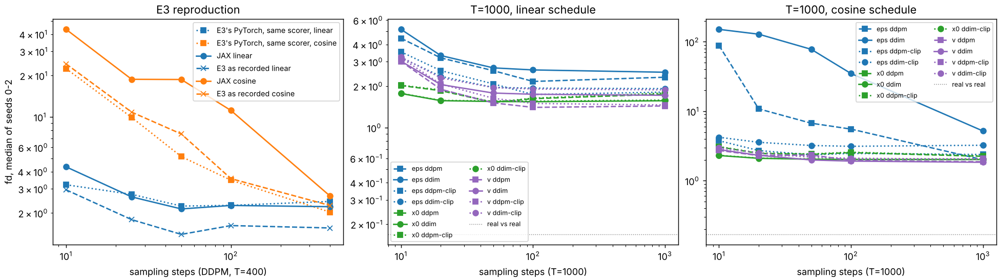

# M7 — Hypergradients, diffusion samplers, a scaling law (N3, N8, O6)

> **Status:** N3 in progress; N8 and O6 to follow ·
> **Hardware:** Kaggle T4 ×2 (one job per GPU), JAX 0.11.1; CPU (4 cores) for the tests ·
> **Data:** N3: [`data/n3-summary.json`](data/n3-summary.json) and [`data/n3/`](data/n3/) (one JSON and log per job; the first run, whose landscape batches were not yet keyed, in `data/n3/first-run/`) ·
> **Reproduce:** N3: `uv run python tools/kaggle/push_r2.py <preset> --push` for `n3b` and `n3c`, then `uv run python experiments/n3_hypergrad/analyze.py`. CPU tests: `uv run pytest tests/test_n3_hypergrad.py`

## N3 — Learning the learning rate: hypergradients through training

### Question

N1 found the 4M transformer's best learning rate by search: 18 runs, one per
(LR, seed). Training is a differentiable function of its learning rate, so
`jax.grad` can, in principle, find that rate by gradient instead. Two
questions:

- **Does the hypergradient point at the tuned LR?** Starting from a point in
  training and looking K steps ahead, which LR does the gradient prefer, and
  how does it compare with the LR the tuned schedule uses at that point?
- **Can it set the LR online?** Train 3,000 steps with the LR updated by its
  own hypergradient every K steps, and compare the final bits/byte with the
  tuned schedule.

The literature predicts a specific failure: **short-horizon bias**.
Hypergradients over short horizons favour small, greedy learning rates,
because a small step reduces the loss soonest even when a larger one would
reach a lower loss later (Wu et al. 2018).

### The idea

**Training is a function, so it has a derivative.** K steps of AdamW map
$(\theta_0, \eta_1, \dots, \eta_K)$ to $\theta_K$. The validation loss after
them, $L_{\text{val}}(\theta_K)$, is a scalar function of the learning rates,
and reverse mode differentiates it through every step: through the forward
and backward passes of each step (a second derivative of the model), through
Adam's moments and bias correction, through the clipping and the weight decay.

**The meta-loss.** Its gradient with respect to $\log \eta$ (log, so that a
step changes the LR by a factor) is the hypergradient. Its zero crossing is
the LR that minimises the loss K steps later: the *K-step-greedy* LR.

**What it costs.** Reverse mode through K steps stores what each step's
backward pass needs. With `jax.checkpoint` around every step, it stores only
the carry ($\theta$, $m$, $v$: three copies of the parameters) per step and
recomputes the rest, so memory grows with K times 50 MB for the 4M model
rather than K times the activations.

### The math

One AdamW step, as ml-ladder's protocol runs it (clipping at global norm 1,
$\beta = (0.9, 0.95)$, $\epsilon = 10^{-8}$, decoupled weight decay
$\lambda = 0.1$):

$$g \leftarrow g \min\!\left(1, \tfrac{1}{\lVert g \rVert}\right), \quad
m \leftarrow \beta_1 m + (1-\beta_1) g, \quad
v \leftarrow \beta_2 v + (1-\beta_2) g^2,$$

$$\theta \leftarrow \theta - \eta \left(\frac{m / (1-\beta_1^t)}{\sqrt{v / (1-\beta_2^t)} + \epsilon} + \lambda \theta\right).$$

The hypergradient for the segment's shared LR is

$$\frac{\partial L_{\text{val}}(\theta_K)}{\partial \log \eta}
= \sum_{k=1}^{K} \eta_k \frac{\partial L_{\text{val}}(\theta_K)}{\partial \eta_k},$$

the sum of the per-step hypergradients; the code computes both. Each
$\partial \theta_K / \partial \eta_k$ propagates through the later steps'
Jacobians $\partial \theta_{j+1} / \partial \theta_j$, which contain the
Hessian of the training loss. That is where the second derivative enters.

**Why a short horizon prefers a small LR.** On a quadratic valley with
curvature $h$, gradient descent at rate $\eta$ shrinks the error along it by
$(1 - \eta h)$ per step. Over a short horizon the loss is dominated by the
highest-curvature directions, which a large $\eta$ overshoots (or destabilises),
while the low-curvature directions, where a large $\eta$ pays, contribute only
over many steps. The greedy optimum therefore sits below the long-run optimum,
and the shorter the horizon, the further below.

### What we measure and why

- **Equivalence (CPU).** The differentiable AdamW equals the training
  optimiser (`jaxexp.train.optimizer("adamw")`) step for step. The
  hypergradient equals a central finite difference (float64), and remat
  changes nothing.
- **The reference.** The tuned protocol in this setting: 3,000 steps of
  64 × 256 bytes, peak 8e-3 (the best LR at T=256 in ml-ladder's
  `c-gpu-lr2-256.json` and in O3), 5% warmup, cosine to 10%, fp32. It saves
  checkpoints at steps 500 and 1,500.
- **The landscape.** From step 0 and the two checkpoints, for K = 10, 30 and
  100: the meta-loss after K steps at nine constant LRs (2.5e-4 to 6.4e-2,
  factors of 2) and its hypergradient. The same K training batches and the
  same 64 held-out windows are used at every LR, so the curve is a
  deterministic function of the LR; they are keyed by (seed, start, K).
  The K-step-greedy LR is the hypergradient's zero crossing; it is compared
  with the schedule's mean LR over the same K steps.
- **Online.** 3,000 steps with no schedule. Every K = 30 steps, the
  hypergradient of the meta-loss after that segment (fresh held-out windows
  each time) updates $\log \eta$ by Adam (step 0.05). It starts from 1e-3
  (too small), 8e-3 (the tuned peak) and 3.2e-2 (too large). Final bits/byte
  is on the same 262,144 validation bytes as every other run.
- **Held-out windows.** The meta-objective's windows come from the validation
  split after its first 1,000,000 bytes, so they never overlap the bytes on
  which bits/byte is reported.

### What I built

- **`jaxexp.hypergrad`:**
  - `adamw_init` and `adamw_step`: ml-ladder's AdamW written out so the LR is a
    traced input. Its square root has a zero derivative at 0 (see below).
  - `make_unroll`: K steps in `lax.scan`, with `jax.checkpoint` on each step.
  - `make_meta_loss`: the validation loss after K steps, as a function of
    $\log \eta$ (one value, or one per step).
- **`experiments/n3_hypergrad/run.py`** (studies `reference`, `landscape`,
  `online`), `analyze.py`, and the Kaggle presets `n3b` and `n3c`.
- **Tests:** `tests/test_n3_hypergrad.py`, 4 tests.
  - **A NaN the tests found.** The attention key bias has a gradient of
    exactly zero, because softmax ignores a shift shared by all keys. Its
    Adam second moment is then exactly 0, the derivative of $\sqrt{v}$ there
    is infinite, and reverse mode multiplies it by zero: NaN in every
    hypergradient. The fix is a square root whose derivative at 0 is 0; the
    forward value is unchanged.
  - **Finite differences on the transformer agree only to 0.13%.** Even in
    float64, the transformer's meta-loss is not smooth below about $10^{-9}$,
    so the exact check uses a small attention-free model (agreement
    $3.5 \times 10^{-9}$). On the transformer, the test checks that reverse
    and forward mode agree.

### Results

N3RESULTS

### What surprised me

N3SURPRISES

### Open threads

N3THREADS

## N8 — Diffusion samplers: DDIM, x0 and v, and the cosine schedule's first step

### Question

E3 trained a 245k-parameter DDPM on MNIST at T = 400 and sampled it with
DDPM's ancestral sampler. Its open threads were DDIM's deterministic sampler,
T = 1000 and v-prediction. Three questions:

- **Does the JAX port reproduce E3?** Same U-Net, data subset, optimiser,
  schedules and sampler; scored by E3's own Fréchet distance.
- **How few steps can each sampler take?** DDPM against DDIM at 10 to 1,000
  steps, for ε-, $x_0$- and v-prediction, linear and cosine schedules, T = 1000.
- **What does a sampler cost when the whole loop is one compiled program?**

### The idea

**One network, three targets.** The forward process is
$x_t = \sqrt{\bar\alpha_t}\, x_0 + \sqrt{1-\bar\alpha_t}\, \epsilon$. The
network can be trained to output ε (DDPM), $x_0$, or
$v = \sqrt{\bar\alpha_t}\, \epsilon - \sqrt{1-\bar\alpha_t}\, x_0$ (Salimans
and Ho 2022). Any one of them, with $x_t$, determines the other two, so every
sampler runs on every parameterisation.

**Two samplers on the same network.** DDPM's ancestral step adds fresh noise
at every step. DDIM with $\eta = 0$ is deterministic: it predicts $x_0$ and
re-noises it to the next retained timestep along the predicted ε. Both can
skip timesteps; E3 strides DDPM by recomputing the effective $\alpha$ between
retained steps.

### The math

From an ε-prediction, the clean image is

$$\hat x_0 = \frac{x_t - \sqrt{1-\bar\alpha_t}\,\hat\epsilon}{\sqrt{\bar\alpha_t}},$$

and DDIM's update to the previous retained timestep $s < t$ is

$$x_s = \sqrt{\bar\alpha_s}\, \hat x_0 + \sqrt{1-\bar\alpha_s}\, \hat\epsilon.$$

An error $\delta$ in $\hat\epsilon$ moves $x_s$ by

$$\left(\sqrt{\bar\alpha_s}\,\sqrt{\frac{1-\bar\alpha_t}{\bar\alpha_t}} - \sqrt{1-\bar\alpha_s}\right)\delta .$$

At the first step, $t = T - 1$. **The cosine schedule ends at
$\bar\alpha_T = 2.4 \times 10^{-9}$** (T = 1000; linear: $4.0 \times 10^{-5}$).
With 10 steps, the first jump goes to $s = 888$, where $\bar\alpha_s = 0.030$.
That multiplies $\delta$ by about 3,500 under the cosine schedule and by 1.9
under the linear one. At 1,000 steps the factor is 31 (cosine) against 0.01
(linear). ε-prediction is therefore fragile exactly where few-step sampling
needs it. $x_0$- and v-prediction never divide by $\sqrt{\bar\alpha_t}$.
Clipping $\hat x_0$ to the data range $[-1, 1]$, then recomputing
$\hat\epsilon$ from it, bounds the damage.

### What we measure and why

- **E3's arm** (T = 400, ε, linear and cosine; DDPM at 10, 25, 50, 100 and
  400 steps), seeds 0–2. E3's protocol throughout:
  - the same 12,000 training and 2,000 test images per seed (`rng.choice`
    with `default_rng(seed)`);
  - AdamW at 2e-3, weight decay $10^{-5}$, batch 128, 16 epochs;
  - 500 samples per score.
- **An in-job PyTorch control.** E3's own `UNet`, schedules, training loop
  and sampler, run in the same job on the same GPU and scored by the same
  scorer. ml-ladder's E3 numbers were recorded on a CPU, so this control
  separates "JAX differs" from "the hardware differs".
- **T = 1000.** Every combination of {ε, $x_0$, v} × {linear, cosine} is
  trained under E3's protocol. Each is sampled by DDPM and DDIM, each with and
  without $x_0$ clipping, at 10, 20, 50, 100 and 1,000 steps. The LR is E3's
  for every arm; it was not re-tuned per parameterisation.
- **The score.** ml-ladder's `generative` fd: a Fréchet distance in the
  feature space of a small classifier, trained per seed on that seed's
  training images (CPU, 2 epochs), between 500 samples and 500 test images.
  The floor is fd between two disjoint sets of 500 test images.
- **Cost.** Wall time of one compiled sampling run of 500 images, after a
  warm-up call.

### What I built

- **`jaxexp.diffusion`:**
  - E3's schedules (verbatim) and its U-Net, written as pure functions with
    PyTorch's layer semantics and initialisation;
  - `from_torch`, which loads E3's weights;
  - the loss for each parameterisation;
  - `sample`, which runs DDPM or DDIM (optionally clipped) as one
    `lax.scan` over E3's timestep subsequence.
- **`experiments/n8_diffusion/run.py`:**
  - arms `e3`, `e3torch` and `t1000`, scored by ml-ladder's scorer;
  - `analyze.py`;
  - `diag_seed2.py`, a CPU diagnosis of one outlying seed.
- **Tests:** `tests/test_n8_diffusion.py`, 46 tests.
  - The JAX U-Net matches E3's PyTorch U-Net on loaded weights.
  - Each parameterisation's output converts back to (ε, $x_0$).
  - If the data is a single image, the exact denoiser is known in closed
    form. With it, every sampler, parameterisation and step count (10, 50,
    1,000) ends at that image, to $10^{-4}$.
- **A race fixed on the way.** n8b's two GPU lanes downloaded MNIST into the
  same directory at once, and one read the other's partial file (SHA
  mismatch). `jaxexp.data` now downloads to a per-process temporary file and
  renames it into place.

### Results

fd is a median over seeds 0–2 with min–max; lower is better. Two disjoint
sets of 500 test images score 0.17 (0.10–0.28), the floor. Seed noise is
large: the same configuration often spans a factor of 2–5 across seeds. So
comparisons between *separately trained models* (parameterisation, schedule,
framework) need a pattern that holds seed by seed. Comparisons *within one
model* (sampler, clipping, step count) are paired and much cleaner.

**E3 reproduces, within seed noise.** E3's arm at 400 DDPM steps:

| | linear | cosine |
|---|---|---|
| JAX (this port) | 2.22 (1.78–6.94) | 2.65 (0.87–20.04) |
| E3's PyTorch, same job, same scorer | 2.43 (1.57–2.76) | 2.03 (1.24–2.41) |
| E3 as recorded (ml-ladder, CPU) | 1.56 (1.42–2.23) | 2.27 (1.25–2.50) |

The final training MSE matches E3's (seed 0: 0.0284 linear in both JAX and
PyTorch; cosine 0.0471 against 0.0465). The JAX medians lie inside PyTorch's
range. **Seed 2's JAX models are the outliers (6.94 and 20.04), and the
diagnosis shows the cause is the seed, not JAX.** Retrained on CPU, seed 2's
linear model again samples thin, faint digits (fd 4.05; mean pixel 0.080
against MNIST's 0.131). Changing only the training key gives 2.40; changing
only the data order gives 1.64; another sampling key changes nothing
(4.04). E3 trains at a constant LR with no weight averaging, so the final
weights are a draw from the end of a noisy trajectory, and seed 2's draw is
a bad one. The first run of this study (`data/n8/first-run/`) drew the same
outlier (4.93 and 17.22).

**Cosine ε collapses at few steps; clipping $\hat x_0$ fixes it.** T = 1000,
cosine, ε-prediction:

| steps | DDPM | DDIM | DDPM, $x_0$ clipped | DDIM, $x_0$ clipped |
|---|---|---|---|---|
| 10 | 88.5 (32.4–113.0) | 150.9 (79.0–193.1) | 3.77 (2.45–5.59) | 4.22 (2.67–7.82) |
| 20 | 10.8 (8.6–14.6) | 128.6 (63.1–167.5) | 2.72 (1.89–3.25) | 3.57 (2.07–5.52) |
| 100 | 5.54 (2.76–10.70) | 34.9 (14.0–48.1) | 2.47 (1.63–2.87) | 3.13 (1.97–4.52) |
| 1000 | 2.00 (1.84–3.16) | 5.19 (3.54–17.78) | 2.38 (1.75–3.19) | 3.24 (1.91–4.47) |

Model by model, clipping divides the 10-step DDPM fd by 12 to 33. This is
the amplification of the first step in action: a gain of about 3,500 at
10 steps (see The math). E3's sampler does not clip, and E3's own cosine
fd at 10 steps ranged from 9.0 to 153 across its seeds.

**$x_0$-prediction is the few-step choice; v is the best at full length.**
T = 1000:

| | 10 steps | 20 steps | 100 steps | 1,000 steps |
|---|---|---|---|---|
| ε, linear, DDPM | 4.44 (3.31–5.36) | 3.20 (2.41–3.73) | 2.16 (1.74–3.03) | 2.32 (1.73–3.34) |
| $x_0$, linear, DDIM | 1.77 (1.61–3.54) | 1.57 (1.38–3.38) | 1.54 (1.35–3.28) | 1.57 (1.32–3.41) |
| $x_0$, cosine, DDIM | 2.30 (2.26–2.81) | 2.10 (2.05–2.66) | 2.03 (1.98–2.61) | 2.02 (2.00–2.65) |
| v, linear, DDPM | 3.02 (2.61–4.96) | 1.90 (1.71–3.57) | 1.40 (1.19–3.29) | 1.44 (1.17–3.35) |
| v, cosine, DDIM | 2.81 (2.00–3.11) | 2.32 (1.69–2.61) | 1.92 (1.57–2.46) | 1.84 (1.55–2.44) |

- **Steps to converge.** With DDIM, $x_0$-prediction reaches within 10% of
  its own 1,000-step fd by 10–20 steps on every seed and both schedules.
  Under the linear schedule ε-prediction needs 50 steps with DDIM and 50–100
  with DDPM. Under the cosine schedule it needs 100–1,000 (DDIM) or the full
  1,000 (DDPM).
- **On every seed the best sampler at 20 steps or fewer predicts $x_0$ or v,
  never ε.** Overall bests: linear v-DDPM, 1.40 at 100 steps; linear
  $x_0$-DDPM, 1.52 at 50.
- **Clipping is a fix for ε, not a free improvement.** Within each model,
  clipping changes $x_0$-prediction's fd by at most 5% (its estimate rarely
  leaves $[-1, 1]$). It never helps v-prediction at 20 steps or more: 0–16%
  *worse*, on every seed.
- **DDIM against DDPM depends on the model.** For $x_0$ under the cosine
  schedule DDIM is better on every seed at 10–20 steps (0.54–0.92× DDPM's
  fd), but not at 100 or more (seed 1: 1.11–1.13×). For linear ε, linear
  $x_0$ and v it is better on some seeds and worse on others; for unclipped
  cosine ε it is far worse.
- **T = 1000 does not beat T = 400 for E3's own model.** Linear ε-DDPM at
  full length: 2.32 (1.73–3.34) at T = 1000, against 2.22 (1.78–6.94) at
  T = 400.

**Cost.** One sampling run of 500 images costs 28 ms per step in JAX (27–29
across samplers and step counts), against 40–41 ms for E3's PyTorch loop on
the same T4: 1.4× faster. Clipping and DDIM are free. Because the loop is one
`lax.scan`, compiling takes 1.4–3.6 s whatever the step count. Training
takes about the same in both (16 epochs: 47–55 s in JAX, 45 s in PyTorch).

### What surprised me

- **A bad seed that reproduces.** XLA on a GPU is not deterministic, yet
  seed 2's E3 models were bad in both GPU runs and again on a CPU. Its
  training loss was normal (0.0282 against 0.0275–0.0284), so nothing in
  training flagged it. What stays fixed under all that run-to-run noise is
  the trajectory's seed, and the final weights of constant-LR training
  without averaging are a lottery ticket that the seed draws.
- **The cosine schedule is the fragile one.** It is usually introduced as
  the better schedule. With ε-prediction and few steps it is the worst
  configuration here by an order of magnitude, because it drives
  $\bar\alpha_T$ to $2.4 \times 10^{-9}$, and the first step divides by its
  square root.
- **Clipping $\hat x_0$ is not a free improvement.** It rescues cosine ε and
  never helps v at 20 steps or more.
- **More diffusion steps did not help E3's model.** T = 1000 matched
  T = 400 at full length, and the gains of this study came from the
  parameterisation and the sampler, not from T.

### Open threads

- **Weight averaging.** An EMA of the weights is standard practice and should
  remove the final-iterate lottery. The one tried here (decay 0.999 over
  only 1,500 steps, no bias correction) still carried 22% of the initial
  weights and was worse (`data/n8/seed2-diagnosis.json`). A shorter decay or
  a bias-corrected average is the next thing to try.
- **Tune each parameterisation.** All arms used E3's LR. The three losses
  differ in scale (final MSE, linear schedule: ε 0.029, $x_0$ 0.154, v 0.183),
  so one LR need not suit all three. "Tune every arm" was not followed here.
- **More seeds or more samples.** Differences under about 1 fd between
  separately trained models are inside the seed noise of three seeds and
  500 samples.
- **Higher-order samplers** (DPM-Solver, Heun) are the obvious next arm for
  the few-step regime.
