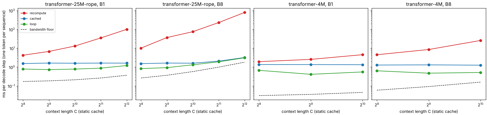

## O4 — KV-cached decoding, compiled

### Question

ml-ladder's C3 and C5 explain why a decoder caches keys and values: without a
cache every new token recomputes the whole prefix, $O(T^2)$ work per token; with
one it reads the cache once, $O(T)$. C5 adds that decoding is then
memory-bound: per token, the GPU must read every weight and the whole cache,
and arithmetic is trivial next to that. C5's open thread asked for the check:
the bytes a step reads, divided by the card's bandwidth, against measured
tokens/s at several context lengths.

In JAX the question has a second half. A cached decode step is a small jitted
function called once per token. How much does it cost to call it from Python,
and does putting the whole generation inside one compiled program
(`lax.fori_loop`) reach the bandwidth floor? That is what the candle fork's
static decode did with preallocated buffers replayed in a CUDA graph
(davidmiheev/candle#3 and #4).

### The idea

**Static shapes.** XLA compiles one program per input shape, so a cache that
grows by one token per step would recompile every step. Instead the cache is
preallocated for $C$ positions, the step writes the new key and value at
position $p$ with `lax.dynamic_update_slice` and attends over all $C$ slots under a
mask that hides positions after $p$. Every step has the same shape, so one
compiled program serves the whole generation. The price is that attention
reads all $C$ slots, used or not.

**Three decoders**, all greedy so that they must emit the same tokens:

- **recompute** — no cache: a full forward pass over a $[B, C]$ buffer per token,
  reading the logits at the current position;
- **cached** — prefill the prompt in one parallel pass, then one jitted step
  per token, called from a Python loop (the cache buffer is donated, so XLA
  updates it in place);
- **loop** — prefill and all steps inside one jitted `lax.fori_loop`.

### The math

**Bytes per cached step** at batch $B$, context $C$, $L$ layers of width $d$,
with fp16 weights and cache:

$$\text{bytes} = 2N + 2 \cdot 2 L B C d,$$

the $N$ weights read once, plus the whole static cache, keys and values. At
the T4's 320 GB/s this gives the *bandwidth floor* on a step's time. For the
25M RoPE model ($L = 8$, $d = 512$): weights 51 MB; the cache is 16.8 MB at
$C = 1024$, $B = 1$, and 537 MB at $C = 4096$, $B = 8$, where it is ten
times the weights.

**Recompute** does a full forward pass over $B \times C$ tokens per generated
token: $2NBC$ FLOPs for the matmuls plus $O(L B C^2 d)$ for attention. It is
compute-bound and grows at least linearly in $C$, quadratically at long
contexts.

**Launch overhead.** A GPU kernel launch costs a few microseconds. A decode
step of the 25M model compiles to 157 kernels (the 4M: 105). At batch 1 the
whole step should take 0.2 ms by bandwidth, so 157 launches at ~4 µs each
(0.6 ms) would dominate it. A CUDA graph records the launches once and
replays them as one; XLA's equivalent is its command buffers.

### What we measure and why

- **Equivalence (CPU).** The functional forward pass equals the NNX model;
  each cached step's logits equal the full forward pass at that position (to
  $10^{-5}$ in fp32); the three decoders emit identical tokens.
- **Decode cost (T4).** For R2's 25M RoPE transformer at C = 256 to 4096 and
  the 4M (learned positions, so C ≤ 1024), batch 1 and 8, plus batch 32 at
  C = 1024: ms per step after compilation (median of 3), compile time,
  prefill time, XLA's compiled temp memory, and XLA's own estimate of bytes
  accessed per step. A step decodes one token per sequence; 128 tokens are
  generated from a prompt of $C - 128$.
- **Kernel count.** Top-level instructions of the compiled step's
  optimised HLO.
- **Command buffers.** The cached and loop arms with XLA's command buffers
  at their default, off, and enabled for every command type including
  `WHILE`.

Weights are random: a step's cost does not depend on their values.

### What I built

- **`jaxexp.decode`.** `weights(model)` reads a `CharTransformer` into plain
  arrays, matmul weights in fp16 once, up front. `forward` is the model's
  forward pass over those arrays, also returning every layer's keys and
  values. `prefill`, `step`, `empty_cache`, and the three generators
  `make_recompute`, `make_cached`, `make_loop`. Numerics follow
  `transformer.TORCH`; scores and softmax are fp32, as in R2.
- **`experiments/o4_decode/run.py`** and `analyze.py`; Kaggle preset `o4`.
- **Tests.** `tests/test_o4_decode.py`, 8 tests.

### Results

*Milliseconds per decode step (one new token for each of B sequences) against
the static context length C, on one T4 (Colab), fp16. Dashed: the bandwidth
floor, the bytes a cached step must read divided by 320 GB/s.*

**The 25M RoPE transformer, batch 1** (ms per token):

| C | recompute | cached (Python loop) | loop (`fori_loop`) | bandwidth floor | prefill (ms) |
| --- | --- | --- | --- | --- | --- |
| 256 | 4.28 | 1.55 | 0.79 | 0.17 | 3.1 |
| 512 | 6.79 | 1.64 | 0.74 | 0.19 | 5.5 |
| 1024 | 13.13 | 1.61 | 0.79 | 0.21 | 12.1 |
| 2048 | 35.44 | 1.64 | 0.88 | 0.27 | 33.2 |
| 4096 | 101.10 | 1.63 | 1.21 | 0.37 | 95.5 |

**Batch 8** (ms per step of 8 tokens):

| C | recompute | cached | loop | floor |
| --- | --- | --- | --- | --- |
| 256 | 10.18 | 1.53 | 0.83 | 0.27 |
| 1024 | 75.82 | 1.61 | 1.33 | 0.58 |
| 4096 | 800.54 | 3.25 | 3.13 | 1.84 |

and batch 32 at C=1024 (the same 588 MB per step as batch 8 at C=4096):
cached 3.30, loop 3.21, floor 1.84.

- **The cache turns quadratic into flat.** Recompute grows from 4.3 to 101 ms
  per token at batch 1 as C goes from 256 to 4096 (24× for 16× the context),
  and to 801 ms at batch 8. The cached step stays at 1.5–1.6 ms. At C=4096 the
  cache is 62× faster at batch 1 and 246× at batch 8.
- **At batch 1 nothing is bandwidth-bound.** The floor is 0.17–0.37 ms. The
  cached step called from Python costs 1.55–1.64 ms whatever C is; the
  compiled loop halves that (0.74–0.88 ms up to C=2048) and is still 3–5× the
  floor. At C=4096 the loop rises to 1.21 ms as the cache read starts to
  count.
- **Only large steps reach the floor's neighbourhood.** When a step must read
  about 300 MB or more (batch 8 at C ≥ 2048, batch 32 at C=1024), the cached
  and loop arms converge (3.25 / 3.13 ms for 588 MB at batch 8; 3.30 / 3.21 at
  batch 32) at 178–188 GB/s, 56–59% of the T4's 320 GB/s.
- **The bandwidth arithmetic matches XLA's.** XLA's own bytes-accessed
  estimate for a cached step is within 1–9% of the model's weights + whole
  cache at batch 1 for the 25M (1.02–1.09×). For the 4M it is 1.7× (fixed
  costs dominate a 10 MB step), and at batch 8 with short contexts it is
  lower than the model (0.52× at C=256); I did not trace which fusions it
  undercounts.
- **The 4M model is launch-bound everywhere:** cached 1.27–1.37 ms, loop
  0.42–0.68 ms, against a floor of 0.03–0.16 ms.
- **Every decoder emits the same tokens** in 14 of the 17 configurations. In
  the other three, fp16 near-ties: recompute disagrees with the cache on 3.5%
  and 3.1% of tokens (25M, B=8, C=256 and 2048) and 2.7% (4M, B=8, C=1024).
  The cached and loop decoders, which run the same step, always agree.
- **Compile time and memory.** The step compiles in 2.9–5.6 s, the full loop in
  3.9–7.8 s (it includes the prefill), recompute in 1.7–4.6 s. With its cache
  donated, the cached step needs 0.3 MiB of temp memory at batch 1: the
  update happens in place. The loop's temp memory is its prefill's: 890 MiB
  at C=4096, batch 1, and 6.8 GiB at batch 8.

**Where the loop's time goes.** The step compiles to 157 kernels for the 25M
model (105 for the 4M). The loop's time above the bandwidth floor, divided by
the kernel count, is 3.5–3.9 µs per kernel for the 25M at C ≤ 2048, and
3.6–6.1 µs for the 4M: a fixed cost per kernel.

**XLA's command buffers (CUDA graphs),** batch 1, ms per token:

| | cached, 25M C=1024 | loop, 25M C=1024 | cached, 25M C=4096 | loop, 25M C=4096 | cached, 4M | loop, 4M |
| --- | --- | --- | --- | --- | --- | --- |
| off | 2.05 | 0.75 | 2.08 | 1.20 | 1.65 | 0.63 |
| default | 1.71 | 0.79 | 1.70 | 1.26 | 1.39 | 0.67 |
| all, incl. `WHILE` | 1.57 | 0.89 | 1.62 | 1.30 | 1.44 | 0.53 |

- **Command buffers help the step called from Python** (2.05 → 1.57 ms): the
  step's launches are recorded once and replayed.
- **They do not help the loop.** Off, default and all land within 0.14 ms
  of each other, in no consistent order, and that is the run-to-run spread:
  the 4M's default loop measured 0.555 and 0.669 ms in two separate runs.
  So the loop's remaining ~0.55 ms is not host-side launch overhead that a
  graph can remove; it is the device's fixed cost per small kernel. Only
  fewer kernels would lower it.

### What surprised me

- **Python costs more than the model at batch 1.** Dispatching a jitted step
  with a pytree of 117 leaves (100 weight arrays and 17 LayerNorm epsilons) from Python takes about 0.8 ms; the step
  itself, inside the loop, about the same. The candle fork's CUDA graph
  attacked the same cost; here a `fori_loop` gets most of the way without
  one.
- **The CUDA-graph analogue does not finish the job.** XLA's command buffers,
  even with the while loop inside them, leave the loop where it was. On a
  T4, 157 small kernels at ~3.6 µs each are a floor of their own, three times
  the bandwidth floor.
- **The static cache reads empty slots and it rarely matters.** Attention
  reads all C positions every step whether used or not. At batch 1 that is
  invisible (launch-bound); it starts to show only at C=4096 (loop 0.79 →
  1.21 ms).

### Open threads

- **Fewer kernels.** The loop's floor is per-kernel cost. A fused decode step
  (Pallas, on a TPU or an Ampere GPU; the T4 cannot run Pallas) or fusing
  the QKV, rotary and attention of one layer would test how far below
  0.75 ms batch 1 can go.
- **A bucketed cache** (attend over the next power of two above the current
  length via `lax.switch`) would stop reading empty slots; at batch 8 and
  C=4096 it could halve the bytes for the first half of a generation.
- **PyTorch's numbers on the same card.** ml-ladder's decode measurements
  (C5's four real decoders) used other models; the same 25M model in PyTorch
  with and without CUDA graphs would separate framework from hardware.
